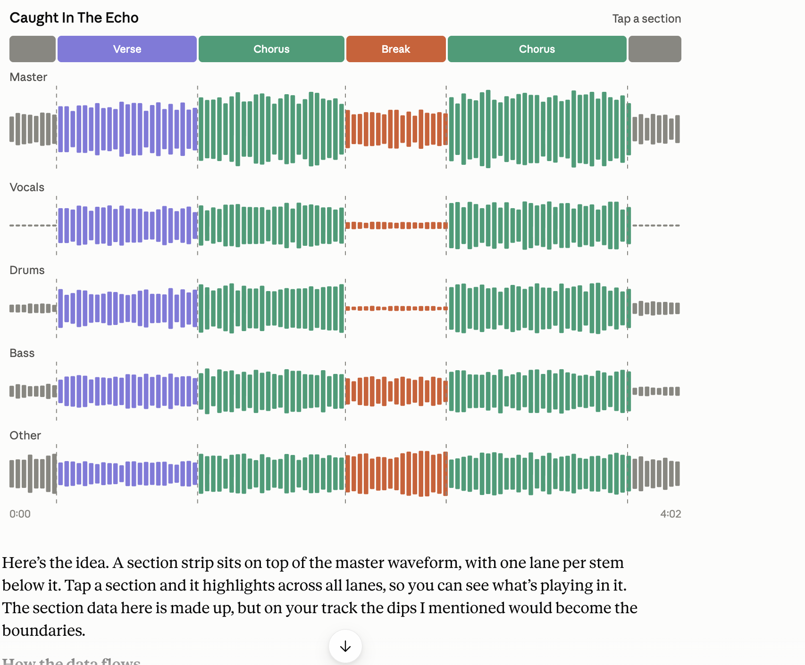

# v1.0 scope and roadmap

Status: **plan.** Everything below is in scope for 1.0. This document orders it, says what depends on what, and defines "done" per item. Detail lives in the per-system docs it links to; this is the map.

Effort: S = days, M = 1–2 weeks, L = several weeks. Feasibility notes come from reading the repo and a first look at the external APIs; anything marked *unverified* needs a check before building.

## Overview

| # | Workstream | Effort | Depends on | State | Priority |
|---|---|---|---|---|---|
| 1 | Stability: cards disappearing, hardware checklist, Spotify API audit, backup/restore | M | | **mostly built** (cards fix, Spotify audit, backup, alerts); the hardware checklist is left | Must |
| 1a | Profiles: Control / Standard / Full, chosen in the setup wizard | M | 1 | design below | Must |
| 1b | Queue stability and management: are the runners stable, per-queue health, pause/cancel/prioritise jobs | M | 1 | partly built; review below | Must (stability), Should (management) |
| 2 | TV control | M | | **mostly built**: V1 page, wake, number keys; remote keys (API, MCP, card) and the Philips key map; Philips power on, volume, Jointspace. **Left:** the V1 one-way command probe, other ASE BeoVision models, Philips HDMI switching (no API on this firmware, fallbacks documented) | Must |
| 2a | Sub devices (devices connected to other devices: converter, Chromecast on a TV, changers) | M | 2 (first case) | design below | Should |
| 3 | Availability layer (external libraries add to the collection) | L | | **mostly built (2026-10-28)**: catalogue tables, MusicBrainz discography sync and linker, read and wish APIs, web discography and wishlist, provider registry, Spotify browse and play; left: Deezer, Tidal and media-server providers, live checks of the MusicBrainz and ListenBrainz response shapes; see [availability-layer.md](availability-layer.md) "Built so far" | Must |
| 4 | Discovery | M | 3 (partly) | **partly built**: new releases (ListenBrainz feed triggers the catalogue sync; API and shelf); rediscover shelves, similar tracks and the Discover hub to do | Should |
| 5 | Deezer and Tidal | L | 3, hardware probes | design in [streaming-services.md](streaming-services.md) | Should |
| 6 | Physical library (CDs, tapes, vinyl) | M | 3 | **started**: physical items by barcode or by hand, the `physical` availability provider, API, MCP, web; changer and tape control not | Should |
| 7 | CD import (ripping) | M | 6 (links to items) | **started**: desktop ripper app (sign-in, upload) and the upload API exist; ripping itself to do | Can slip |
| 8 | Additional features: scenes/automations, podcasts, audiobook resume, tag editor, PWA + alerts, playback history | M–L | varies | to do | Mixed (per item) |
| 8a | Home Assistant: MQTT discovery and automations built in HA | M | 8 (scenes, alerts), 2a (TV events) | plan in [home-assistant.md](home-assistant.md) | Should |
| 8b | Mobile app support: admin API for apps, one-library playlists everywhere, contract gaps, player housekeeping, alerts feed | M–L | 8.6, 8.7 | plan below; the app side is in `~/Code/ReMomentiOS/docs/roadmap.md` | Must (contract items), Should (rest) |
| 9 | Release: docs, OpenAPI, MCP, upgrade path, versioning | S | all | to do | Must |
| 9a | Distribution and upgrades: registry images, compose, Ansible, Pi image, `app:upgrade`, migration squash | L | 1a | design below | Must |
| 9b | Release readiness: CI, end-user docs, network guardrails, performance budget, diagnostics bundle | M | 1a | design below | Must (diagnostics: Should) |
| 10 | Manager: host service that controls the running instance (containers, processes, upgrade with rollback, host stats) and SMB shares (serve and mount) for the library and the drop directory; on every install target | L | 1b, 9a, backup | **decided, design draft** | Must |
| 11 | WiiM (LinkPlay) driver: a dedicated driver on the public HTTP API, on top of the generic UPnP fallback | M | | to do | Should |
| 13 | Export from the library: download a playlist, album or artist as a zip, transcoded to a chosen maximum quality, for an MP3 player or a car radio | M | 1b | to do | Should |
| 14 | Foundations, decided early (phase 2): one alert and event model, stable IDs for clients, a schema review before the migration squash, a shared credentials layer, and an action-layer design spike | M | | **14.1, 14.2 and 14.4 built**; 14.3 (schema review) and 14.5 (spike) to do | Must (14.1, 14.3), Should (14.2, 14.4, 14.5 spike) |
| 15 | Media servers: one abstraction for video (and later music) servers (Jellyfin built as a TV-only feature; Plex, Emby, Kodi follow the same contract), linked to the devices that can play them | M | 14.4, 2a | **started** (Jellyfin shelf); abstraction to do | Should |
| 16 | Track structure and waveform views: a waveform with real contrast, the sections of a track, mood over time, per-stem lanes, similarity by section | M–L | 12.1 (embeddings), 12.10 | 16.1 built | Should (16.1, 16.2), Can slip (16.3-16.5); 16.2-16.4 run on demand per track |
| 12 | Library and audio intelligence, what is left: mixes-well, loudness-normalised playback, tag and cover suggestions, concerts, related works, lyrics extras, listening insights, Essentia on arm64 | S–M each | 4 (similar tracks), 8.4 (tag editor) | plan below; the enrichment, analysis and health base is built | Mixed (per item); platform docs Must |

## Progress (as of 2026-10-27)

Built and committed since this plan was written (hashes are on `main`):

| Item | What | Commit |
|---|---|---|
| 1 Cards | One cause of vanishing cards fixed: a `<style>` before the card's `
` became the Livewire root. **Not yet confirmed** by an hour-long run; other suspects (MQTT refresh, Spotify routing, state flapping) could not be reproduced | `316b979` |
| 1 Spotify audit | Every call listed in [spotify-api-audit.md](spotify-api-audit.md); likes and playlist import moved to the generic endpoints; removed endpoints degrade to "no data". Response shapes **unverified** on a real post-February app | `01932fa` |
| 1 / 9b Spotify keys | Settings card for the user's own Client ID and secret, plus [spotify-app-setup.md](spotify-app-setup.md) | `c39b118` |
| 1 Backup and restore | `backup:run` / `backup:restore`, nightly schedule with retention, health warning; no secrets by default. **Never run against real MariaDB 11.4**; see [backup-restore.md](backup-restore.md) | `a626f9b` |
| 2 TV | Beoplay V1 page, wake by source, number keys | `5d2dab0` |
| 2a Cast | CASTV2 codec, receiver connection, read-only `cast:probe` | `0ff1c58` |
| 7 Ripper | `ripper/`: Tauri desktop app, signs in with the admin token, MusicBrainz disc lookup, tags files, uploads through `POST /api/admin/files`; ripping itself still to do | `d0e24af`, `6ca86f3` |
| 9a Web server | FrankenPHP in classic mode replaces `artisan serve` in production; multi-arch image built natively per host; verified on arm64 only; see [frankenphp.md](frankenphp.md) | `a2ca384` |
| 14.1 Alerts | One alert and event model: `Alerts::raise`/`resolve`, an `alerts` table, MQTT `remoment/alerts/{kind}`, `GET /api/alerts`, admin acknowledge (API, MCP, a button on `/settings/health`); queue stuck, scheduler silent, backup stale, storage unreachable, device offline and listener down raise through it. Redis and MQTT behaviour **not verified** on a running install; see [alerts.md](alerts.md) | `c158db9`, `1ef4f0d` |
| 14.4 Credentials | `ServiceCredentials` registry and one page, Settings › Services & keys (`/settings/services`), for Spotify, Last.fm, Discogs, AcoustID and TheAudioDB: encrypted secrets, masked, excluded from backups by the registry flag, base URL from settings (relay hook reserved, not built), `.env` fallback kept, a migration encrypts plaintext secret rows. Not tried against live services or in a browser; see [credentials.md](credentials.md) | `f6e1370` |
| 2 TV (Philips, keys) | Remote keys: `GET/POST /api/devices/{id}/keys`, MCP, the remote card and the Philips key map; Philips probe results ([philips-tv.md](philips-tv.md): Jointspace 6.4.0, **no HDMI input API on this firmware**), power on through `/6/powerstate` with Wake-on-LAN as a fallback, volume and mute, reachable through Jointspace and Cast without a UPnP renderer, the TV app shown as now playing, brand icons for sources | `686d9c8`, `e6b0433`, `956614d`, `035bca6`, `3125b6b`, `44635c4`, `e853b4b`, `9ef5324` |
| 15 Jellyfin (not in the plan) | A card with continue watching and next up on the Philips TV page, `GET /api/devices/{id}/jellyfin` and `POST .../jellyfin/play`, an MCP tool, titles of the Jellyfin app as now playing, the server key on the credentials page. **TV-only and Jellyfin-only today; unverified against a real server**; to become the media-server abstraction of workstream 15 | `82c88a0`, `f85dbea`, `aab4303` |
| 14.2 Stable IDs | `id_aliases` written by `LibraryMerger` in the merge transaction; `canonical_id` on artist, album and playlist detail; play, queue and favorite accept an old id; web routes 301 | `707be85` |
| 3 Catalogue | `catalogue_artists`, `catalogue_albums`, `album_availability`; MusicBrainz discography sync and linker (`catalogue:sync`, `catalogue:reconcile`); artist mbid search verified by an owned album; read API (discography, wishlist, `?availability=`); wish and ignore endpoints (a wish closes when the album is owned); catalogue rows survive merges; Spotify availability and add; web discography card, wishlist page and shelf; provider registry with ownership. MusicBrainz browse and search shapes **verified against live calls 2026-10-30** (the browse now sends `release-group-status=website-default`); merged-mbid redirect still unverified | `e12814f`, `55bf1ba`, `3916b50`, `602301e`, `152231b`, `2ba2972`, `0c4e07c`, `2a4dfed` |
| 4 New releases | ListenBrainz fresh releases trigger the catalogue sync early; `GET /api/library/new-releases`, MCP, a "New from your artists" shelf. Verified 2026-10-30: no token needed, body `{payload:{releases}}`, rows have a secondary type the scan skips | `580e8a8` |
| 6 Physical | `physical_items` (barcode via MusicBrainz or by hand; barcode lookup fields verified live 2026-10-30), the `physical` provider, API, MCP, web; see [physical.md](../api/physical.md) | `e838366` |
| Not in the plan (2026-10-28) | Wished songs from play history and radio (`wanted_tracks`, `e91ab95`); browsing and playing Spotify live (external catalogue API, artist, album and playlist pages, Streaming scope shelves: `6cfd229`, `1b7b8fb`, `bdddf0a`, `d62fda9`, `7b2542b`, `dec552c`, `1c59ec1`) | see commits |
| 3, 4, 6 Verified live (2026-10-30) | The MusicBrainz release-group browse, artist search and barcode lookup, the ListenBrainz fresh-releases feed (no token needed) and Spotify's artist-albums endpoint were called for real; the sync now asks MusicBrainz for `website-default` groups (417 become 41 for one artist), the new-release scan skips live and compilation rows and defaults to 30 days; real-response fixtures; a client-safety test. **Findings:** only 35% of the library's artists have a MusicBrainz id (the plan assumed 70%), the first full sync is about 1,000 requests (17-20 minutes), and the library's album names are releases with catalogue numbers (see the next row for what that cost) | `9f19854`, `e56d125`, `110fa11` |
| 3 Edition matching | `EditionKey`: a catalogue-only looser key (strips catalogue numbers, region and edition words; word lists in `config/availability.php`), with year and track-count sanity checks, used by the linker and by artist verification; `catalogue:reconcile` re-links existing rows; `Normalizer::album` and `name_key` untouched (a test asserts it). **On the dev library the real gain was small:** Foo Fighters 8 → 10 linked (two EPs); most of its unlinked albums are further pressings of linked groups or singles, and the 9 groups still shown missing really are | `623bc8d`, `a83462d` |
| 16.1 Waveform contrast | `WaveformStage` version 2: RMS per bucket in dB, optional deviation from the local loudness weighted by the track's peak-to-loudness ratio, a per-track 5th to 99th percentile stretch (span 6 to 30 dB); `waveform` stays integers 0-100 so clients are unchanged, raw peaks kept in the internal `waveform_peak`; existing files show as "to redo" until the stage is re-run (`library:analyze --stage=waveform`). Tested with synthetic audio; **not yet judged on real brickwalled tracks in a browser, nor run on a Pi** | `bf8f560` |
| **Direction change** | **Spotify is no longer a library.** The saved-tracks and playlist import, its settings page and the add, import and fill actions are gone; Spotify leaves `LibrarySources::LIBRARIES`; "Local" means own files only and DLNA is a streaming library that counts as owned; a purge migration (`drop_spotify_library_data`, `library:drop-spotify`) removes what the old import left. **Run `library:drop-spotify --dry-run` and `backup:run` before deploying**: favourites on removed items are lost, plays stay as text plays | `1900864`, `e7d2e4b`, `c9f52a4`, `25479fe`, `e8d9686`, `91b72a4` |
| Not in the plan | Move playback and sync groups (fake multiroom); BeoLink stream (B&O multiroom as an Icecast stream for any speaker) | `5b12aec`, `d89bc44` |

Still open on workstream 1: the hardware checklist (needs the device lab) and confirming the card fix over time. The health alerts are built through the alert model (14.1).

**Priority.** *Must* = 1.0 does not ship without it. *Should* = in 1.0 unless time runs out, cut in the order listed under "Cut order". *Can slip* = moves to 1.1 without hurting 1.0. Per-item tags for workstream 8 are on the items below.

**Cut order** (first to go): 8.2 podcasts, 12.8 lyrics extras, 12.7 related works, 12.9 listening insights, 12.6 concerts, 8.4 tag editor (with 12.4 tag suggestions), 8.3 resume position, the HA command path (8a), 12.3 loudness-normalised playback, 7 CD import, 6 physical library, 5 Tidal (Deezer stays if verified), 4 similar tracks. 12.2 (mixes well) and 12.10 (Essentia platform docs) are not cut: one is a few days, the other corrects what the docs promise. 8b's admin endpoints can ship area by area; its contract items (2, 3, 6) are Must because the app and the `features` list depend on them.

Suggested order: 1 and 2 in parallel, with 1a (profiles) right behind 1 because the stack, the scheduler and the budget of 9b depend on it (independent; 2a follows the first TV work), then 3, then 4, 5 and 6 in parallel, then 7, 8 (with 8a after its scenes and alerts), 8b alongside 8 (its contract items first: they block the app and cost little), and 9, 9a and 9b last (the migration squash is the very last step before the release tag). Workstream 3 is the one that shapes the rest, so it is decided first.

---

## 1. Stability

**Goal:** a release nobody has to babysit.

- **Cards disappearing** *(one cause fixed, `316b979`; confirmation pending)*. Reproduce first. Suspects: the Livewire `$wire.$refresh()` triggered by MQTT push re-rendering while a keyed list changes (`remoment-live.js`), the device-list filtering that hides the Spotify device while it is routed (`SpotifyRouting`), and state flapping to `unreachable` between listener restarts. Add a regression test per cause found (a Livewire test for the list, a unit test for the filter). Done when: a device card never vanishes through a state change, a routing change or a listener restart, over an hour with several devices.
- **Hardware checklist** *(not started)*. Work through `refactor-hardware-check.md` on the device lab (GET-only where possible) and record results.
- **Spotify API audit** *(done, `01932fa`, `c39b118`; see [spotify-api-audit.md](spotify-api-audit.md))*. In February 2026 Spotify moved Development Mode to Premium-only, one Client ID per developer, 5 users per ID and a reduced endpoint set, and reportedly removed several endpoints (new releases, artist top tracks, some album metadata); removal for existing apps was postponed ([migration guide](https://developer.spotify.com/documentation/web-api/tutorials/february-2026-migration-guide)). List every Spotify endpoint the server calls, check each against the guide, and replace or guard those at risk (the library endpoints are now generic and URI-based). Done when: no call depends on a removed endpoint, and a removed one degrades to "no data", never an error page.
- **Backup and restore** *(built, `a626f9b`; see [backup-restore.md](backup-restore.md); still to do: restore on a scratch MariaDB, copy archives off the machine)*. The database moved to MariaDB and has a corruption history (`storage/db-recovery/`). Add `backup:run` (database dump + settings + the artwork-independent state: playlists, favourites, plays, device and client config, analysis results) to a configurable location, scheduled, with retention; and `backup:restore` that works on a fresh install. Own audio files are not included (they are the user's files; document how to back them up). Done when: a restore on a clean container reproduces devices, library, playlists, favourites, history and settings.
- **Health** *(built through the alert model of 14.1, `c158db9`: queue stuck, scheduler silent, backup stale, storage unreachable, device offline, listener down)*. Alerts for the failure cases `/settings/health` already detects (device offline, queue stuck, scheduler silent, storage unreachable) through the notification path in workstream 8.

## 1a. Profiles (Control / Standard / Full)

**Goal.** One codebase that runs on a Pi 2 as a device controller and on a mini PC as the full media server, with the user choosing, and the stack honest about what it runs. Decided 2026-10-26.

| Profile | For | Runs | Hardware | Database |
|---|---|---|---|---|
| **Control** | Wall panels (ESP32), a few devices | Device listeners, REST API, MQTT, live web UI, radio, play history | Pi 2 and up | **SQLite** |
| **Standard** | Control plus a library | Adds library scan, enrichment, artwork, Spotify/DLNA, own-file indexing, MariaDB search | Pi 3 and up | MariaDB |
| **Full** | Everything | Adds audio analysis and the ML sidecar, discovery sync, rip upload, optional Meilisearch | the Recommended and Essentia tiers of [system-requirements.md](system-requirements.md) | MariaDB |

- **A real switch.** A setting (and `.env` value) picked in the setup wizard that turns off the listeners, scheduled jobs and queues a profile does not need. Jobs like the five-minute library cache warm and the nightly analysis must not run in Control. Compose profiles keep the heavy containers (analysis, icecast, Meilisearch) out of the lower profiles.
- **Reported to clients.** `GET /api/info` `features` (workstream 8.7) includes the active profile.
- **SQLite for Control: conditions.** SQLite failed in 2026-10 (lock contention and bind-mount corruption, see [database.md](database.md)); Control only works if (1) WAL mode and a `busy_timeout`, on a native or named volume, never a bind mount; (2) Redis keeps queue, cache and sessions; (3) play history is written by a single worker; (4) a **24-hour stress test** with real listeners counts `database is locked` and gates the decision; if it fails, the Pi 2 is not supported rather than flaky; (5) the backup of workstream 1 covers an SD-card install.
- **Upgrading a profile.** Control to Standard is SQLite to MariaDB: wrap the existing `db:import-sqlite` in a `profile:upgrade` command (backup, switch `.env`, migrate, import).
- **Meilisearch** is removed from `docker-compose.prod.yml` for Control and Standard (it costs hundreds of MB); Full may enable it as an optional compose profile. Whether search is built on it is a separate decision; Standard uses MariaDB search.
- **Web server on a Pi 2.** FrankenPHP (classic mode) is in place and its official image includes armv7, but it has only been verified on arm64 (see 9a, web server and [frankenphp.md](frankenphp.md)); the Pi 2 still needs a measured run.
- **Pi 2 is 32-bit armv7.** Every image in the Control stack (app, Redis, Mosquitto) needs an armv7 build; *unverified*. If one is missing, the Control floor is the Pi 3 (arm64).

Done when: the wizard offers the three profiles, each starts only what it should, a Pi 2 and a Pi 3 meet the budget of 9b for their profile, and moving Control to Standard keeps the data.

## 1b. Queue stability and management

**Goal.** The queue runners keep running without attention, and the admin can see and steer what is in them.

**What exists today** (read from the repo, not from a running install):
- Supervisor (`docker/8.4/supervisord.prod.conf`) runs `queue` (`QUEUE_WORKERS` workers on `health,default`, `--tries=3 --max-time=3600`), `storage-queue` (scans and imports, `--timeout=3600`), `analysis-queue` (`nice -n 15`, `--timeout=900`), the `scheduler` and the `listeners` (`device:listen`), all with `autorestart` and retries without limit so a Redis that is not up yet does not leave a program stuck in FATAL.
- Redis is the queue driver in production; `retry_after` is 3700 s, above the longest job timeout (a comment records the earlier `MaxAttemptsExceededException` this fixed).
- `/settings/health` has a Queue tab (`QueueManager`, `Domain/Health/QueueInspector`): pending jobs by class (waiting, running, delayed), failed jobs with retry, forget and clear, a worker restart (`queue:restart`) and re-queueing missing enrichment.

**Review (a session can do this from the configuration; the soak part needs a real run):**
1. Worker settings against the Pi budget: no `--memory` limit set (the default of 128 MB applies), `QUEUE_WORKERS` default on a 1 GB board, `--max-time` and `--max-jobs` so a leaking job class cannot grow a worker for an hour.
2. Timeouts and `retry_after` for every queue, including any job class with its own `$timeout` longer than its queue's `--timeout`.
3. Failure behaviour: which job classes retry forever, which are idempotent, what a failed job leaves behind (a half-imported file, a stuck "running" marker), and `failed_jobs` growth.
4. Heartbeats: `health:queue` is one timestamp; per-queue worker heartbeats and the age of the oldest waiting job per queue are what actually show a stuck `analysis` or `storage` runner.
5. A **soak test**: a 24-hour run with real listeners and a busy library scan (the same run as the SQLite stress test of 1a), counting failed jobs, restarts, memory per worker and the oldest-waiting age.

**Management additions:** pause and resume one queue, cancel a pending job, move a job class to another queue or change its priority, per-queue concurrency (`storage` and `analysis` stay at one), a live view of what each worker runs now and for how long, and the failed-job list with the exception and the payload's entity (the track or file) instead of the class name alone. Alerts (the alert model of 14.1) for "queue X has not progressed for N minutes". All of it behind the admin login and, for apps, the admin API of 8b.

Done when: the review's findings are fixed or written down, a 24-hour soak shows no stuck queue and no unexplained failed job, per-queue health shows on `/settings/health` and in `/api/info` `features`/alerts, and an admin can pause a queue and cancel a job without a shell.

## 2. TV control

The B&O design and what is built are in [beovision-tv.md](beovision-tv.md); the generic TV model and the Philips plan are in [tv-devices.md](tv-devices.md). Scope for 1.0:

1. **Remote keys.** `POST /api/devices/{id}/keys` (`{ key }`, 422 for a key outside `supportedKeys()`), OpenAPI, MCP tool, and a remote card on the device page for devices with `remote_control`. For B&O the transport is known: B&O's one-way commands (`POST BeoZone/Zone/Stream/Cursor/Select`, `Menu/Root`, `Generic/Red`, ...), mapped from `RemoteKey` in beovision-tv.md. **Unverified on the V1 firmware**: a hardware probe (someone at the TV) comes first and decides `supportedKeys()`.
2. **Philips Android TV**: map `RemoteKey` to Jointspace key names through `POST /6/input/key`; `supportedKeys()` from what the firmware answers. HDMI input switching is *unverified* on current firmware (investigate `Source` + cursor/OK, and `activities/launch` intents).
3. **BeoVision / Beoplay V1: done in phase 1** (commit `5d2dab0`): the V1 is a model with its listener; sources carry `input` and `signal`; the device page has Input and Apps tiles, number keys, sleep timer and a Power on button. Other ASE BeoVision models beyond the V1 still have to be checked (same API family, not verified). A Mozart-platform BeoVision cannot be probed, so it is *unverified* and **out of 1.0 unless a unit becomes available** (Mozart's B&O products are soundbars; their TVs run webOS, a later driver). `ConverterDigitTransport` is the precedent for keys through another device.
4. **Inputs in the UI: done for ASE TVs** (names, icons, `input` label, signal dot, default input on wake through `SwitchToDefaultSource`). Philips has apps only until its HDMI switching is solved (item 2).
5. **Wake: done for B&O TVs**: sending a source turns the TV on, so `powerOn()` activates the default or first visible source (verified by the user on the V1, not yet exercised by an automated hardware run). Wake-on-LAN from a stored MAC, or CEC through another device, is still open for the Philips TV.

Done when: the Philips TV and the Beoplay V1 can be controlled from the web page, the API and MCP, with power, volume, inputs or apps, and remote keys, and what a model cannot do is not offered (capability, not brand). **Left to reach it:** item 1 for the V1 (the probe of which one-way commands it accepts, then `RemoteControlInterface` on the ASE video driver) and Philips HDMI switching (no Jointspace call on the lab firmware, see philips-tv.md). Built: keys API, MCP tool, remote card and the Philips key map (item 2, keys part).

## 2a. Sub devices

**Concept.** A **sub device** is a device in its own right (a player or something we can control, with its own driver, id, card, API and MQTT topic) that is **connected to another device**, its **host**. The link itself can be device-controlled: the host decides whether the sub device is heard or seen, and commands to the host (a borrowed source, an HDMI input) switch it in. Nothing about the sub device's own control changes; the link adds the relation and the routing between the two.

**Cases that exist or are planned:**

| Sub device | Host | The link | Controlled by |
|---|---|---|---|
| BeoLink Converter NL/ML (`ConverterDriver`) | an ASE player that borrows its source | the player's `borrowSource` on `BeoZone/System/Products`; the converter's sources show on the player as `borrowed` | the player (borrow, activate the converter's source); `SessionHostInterface::addListener()` on the converter joins a player to it |
| Chromecast (dongle) on a TV | a TV: **the Beoplay V1, a Chromecast on its HDMI 1 (named "SET-TOP BOX" on the V1)**; later a Philips TV | the TV's HDMI input the dongle is plugged into | the TV's source activation (HDMI switching works on an ASE TV such as the V1, which also reports `signal` per input; *unverified* on Philips, see 2.2) |
| CD changer / tape deck | a player or converter that has the source | a source with controls from `config/control-profiles.php` (workstream 6) | the host's source activation, then `ConverterDigitTransport`-style keys through the host |

A TV with Chromecast **built in** is not a sub device: Cast is a second playback transport on the same device (a separate Cast design doc is not written yet; the driver is in `app/Integrations/Cast/`). Only a separate box behind the TV is one.

**Today** the relation is not modelled: the converter's link is the `converter_jid` meta key plus converter-specific code, and `ConverterDigitTransport` is the one place that sends a sub device's keys through its host. 2a makes that general.

**Design (to settle in the first PR):**
- **Link record.** A `device_links` table: `device_id` (the sub device), `host_device_id`, `kind` (`borrow`, `input`, `source`), `via` (source id or input label, e.g. `HDMI 2`), `meta` JSON. Many-to-many: one converter serves several players; a TV hosts several boxes. One level deep for 1.0 (a sub device is not itself a host).
- **Both stay full devices.** Each keeps its own row, driver, listener and cache. The `/devices` grid keeps listing both (whether sub devices nest under the host card is a UI decision, below).
- **Host exposes the sub device.** The host's source list gets an entry for the link (`AvailableSource` with `input` = `via`); activating it switches the host and, where the driver can, starts the sub device. `active` on that source is true while the host's active input or source matches the link.
- **Routing while active.** Transport commands (play, pause, next, seek, queue) sent to the host go to the sub device while the link is active; volume, power and the other sources stay with the host. This is the pattern of `SpotifyRouting` (one device from two, for commands, capabilities and lists); build it as a generalisation of that class, not a second copy. Now playing and artwork of the sub device are shown on the host's card while it is active (the converter's `playsLocally` is the precedent for telling who actually outputs the sound).
- **API.** `DeviceDetailResource` gains `host` (`{ id, name, via }` or `null`) and `sub_devices` (`[{ id, name, via, active }]`); a `sub_devices` capability on hosts. OpenAPI, MCP and CLAUDE.md follow the usual rule.
- **Setup.** A "Connected devices" card on the device edit page to add or remove a link by hand; automatic suggestions only where a device reports the relation itself (the converter's entry in the player's `Products` list).

**Build order.**
1. `device_links` model, the card, API read, and the migration of the converter link (`converter_jid` stays the identity; the link replaces the hard-wired borrow code paths).
2. Source entries and routing on the host (generalised `SpotifyRouting`); `ConverterDigitTransport` reads the link instead of looking the converter up.
3. First new sub device: the Chromecast on the Beoplay V1's HDMI 1 (`hdmi_1`, link `kind` = `input`, `via` = `hdmi_1`), using the Cast driver (`app/Integrations/Cast/`, started: message codec, connection, `cast:probe`). Needs TV input switching for the active-link state: the Beoplay V1 already has it (activating an HDMI source, `active` and `signal` per input), so the V1 can be the first host; on the Philips TV (2.2) the link stays manual with an unknown state until switching is solved.

**Decided:**
- **Nesting.** A sub device that cannot be controlled by itself (a Chromecast dongle, a CD changer behind a line-in) has **no card in the `/devices` grid**: it is shown only nested in its host's card, and only while the link is active (the host's matching input or source is selected). Its own page is not listed; it is reached from the host card. It is still a full device underneath (own id, driver and listener, usable through the API and MCP). A sub device that **can be controlled by itself**, such as the NL/ML converter (its sources, listener join and now playing work without a player), keeps its own card in the grid and is also nested while its link is active. Whether a driver counts as self-controllable is a flag on the device model (`standalone`), not a guess from capabilities.
- **Link defaults.** A link can carry actions for the sub device that run when the link becomes active (and optionally when it ends): a power on, a power off, a source. Example: a CD changer wired to the line-in of a player, controlled by an ESP; selecting that line-in on the player sends the power-on command to the ESP, leaving it sends the power-off. Stored on the link (`meta`: `on_activate`, `on_deactivate`), run by the host's source listener when it sees the input change, not only when the change came from us (a remote or the TV's own menu counts too).
- **Follow (sub device wakes its host).** The other direction of the link: when the sub device starts playing, the host selects the link. This is what makes a Chromecast usable behind a TV that has no CEC and cannot be woken by the dongle: the Chromecast (its own device, Cast driver) reports a cast session, and the rule activates `hdmi_1` on the Beoplay V1, which both wakes the V1 and switches it to that input. Stored on the link next to the defaults (`meta`: `follow`: `off` | `from_standby` | `always`, `follow_off_after` minutes or null), default `from_standby`.
  - *Trigger:* a session start seen by the sub device's listener (an app launched and playing), after a short debounce (apps start and stop several times in a row). The Chromecast's idle backdrop/ambient app does not count. `isActiveInput` is not used: the dongle only reports it over CEC.
  - *Guard:* `from_standby` switches only when the host is in standby, or already on the link's input; `always` also takes the screen from another input; `off` disables it. A host on another input is never switched by default, so a cast does not interrupt the set-top box.
  - *Turning off:* with `follow_off_after` set, the host goes to standby that long after the sub device stops, but **only if the follow rule woke it** (kept as state on the link), never a TV someone turned on themselves.
  - *Needs:* the sub device must stay reachable while the host is in standby (see the power note in [beovision-tv.md](beovision-tv.md), "Chromecast on HDMI 1"), and the host must switch input by API (the V1 does; Philips is unverified).

**Open (decide while building 1):** how a sub device that is only reachable through its host (converter off, TV in standby, a changer behind a powered-down input) is shown. This only matters for self-controllable sub devices and for the nested card, because the others are hidden when the link is inactive. Options: `unreachable` as today (simple, but the card looks broken while it is just not selected), `standby` derived from the link (the host is up and the link is inactive), or a separate state shown only on nested cards. No preference yet; pick one when the first link is built and the real behaviour of the converter and the ESP is visible.

Done when: the converter and the Chromecast on the V1's HDMI 1 are each linked to a host, the host lists them as sources and routes transport commands while active, casting to the Chromecast with the V1 in standby wakes the V1 on HDMI 1, `GET /api/devices/{id}` shows the relation both ways, and removing the link leaves both devices working on their own.

## 3. Availability layer (external libraries add to the collection)

**Status (2026-10-28): mostly built**, in a day-long session that went well beyond the design document; see the progress table and "Built so far" in [availability-layer.md](availability-layer.md). **The model changed during the build:** Spotify is no longer imported into the library; the library is the local tracks (own files, and DLNA as a streaming library that counts as owned) and streaming services extend it **live** (browse, play, wish; no add or fill from Spotify). The four decisions below still hold; the answers to the design document's nine questions are in that document, not here. Left: Deezer and Tidal and media servers as providers (5, 15), a live check of the MusicBrainz browse and barcode response shapes, and the schema review (14.3). Edition matching (release-style library names such as `Title Special Edition (cat no)` link to their release-group) is built.

**Problem.** Spotify is a hosted copy of what the user saved. Albums the user lacks, new releases and what a service can play on which device are not visible, and Deezer and Tidal would repeat the pattern.

**Design.** On top of `LibraryIdentity` (one record per artist, album and track) an album gets an **availability**: where it can be had.

| Availability | Meaning | Playable how |
|---|---|---|
| `owned` | own files (and physical items, workstream 6) | stream from this server / DLNA |
| `streamable` | on a service, per library (`spotify`, `deezer`, `tidal`) | per library and **per device** (`LibrarySources::playableOn`) |
| `known` | in the catalogue (MusicBrainz) only | not playable: a **wanted** candidate |

- New table (name to settle, e.g. `album_availability`): album id, provider (`files`, `dlna`, `spotify`, `deezer`, `tidal`, `physical`), external id, last checked. Sync jobs write it; the existing `Metadata` rows (`spotify_album_uri`, later `deezer_album_id`) stay the id source.
- **Discography.** An artist page lists the artist's full discography from MusicBrainz release-groups (albums, EPs, optionally singles/live/compilations), each marked owned / streamable / missing. Release-group rows for albums the user lacks are stored as `known` albums with `hidden` from normal browsing, so they never appear in counts, shuffle or the touch clients unless asked for.
- **Wishlist.** The user marks a `known` or `streamable` album as wanted. Wanted shows in a shelf and in the API. When a wanted album becomes owned (import, physical item), the wish closes by itself.
- **Spotify becomes a provider**, not a special case: saved albums remain streamable availability, and the same sync can also record Spotify availability for albums the user does *not* save (a search by artist + album, conservative match as in [streaming-services.md](streaming-services.md)) so "playable on Spotify" does not depend on having saved it.
- **Scope.** The scope switch (`local`, `streaming`, a library id, `all`) keeps working; availability adds a filter, not a new scope: `?availability=owned|streamable|missing`.
- **Clients.** Touch clients and the artwork pre-cache only see owned and streamable (as today); `known` rows never reach them.

**Decisions (settled):**

1. The discography shows **albums and EPs only** by default. Singles, live albums and compilations are not in it (a toggle may come later, not for 1.0).
2. The wishlist is **household-wide**, like favourites.
3. Missing albums live in **their own table** (`catalogue_albums`), so no existing album query changes; an album is promoted to a real `albums` row when it is imported or becomes owned.
4. **MusicBrainz release-groups are the authority** for what counts as missing, with a manual "I don't want this" per release-group.

Done when: an artist page shows owned, streamable and missing albums, a missing album can be wished for and shows up in the wishlist, an imported album closes its wish, and nothing changes for existing browse endpoints and clients.

**Feasibility:** high; mostly data modelling and sync jobs on pieces that exist (MusicBrainz client with rate limits, `Normalizer`, enrichment jobs, `library:enrich`). The cost is the migration and the UI, not new external dependencies.

## 4. Discovery

**Status (2026-10-28):** the **new releases** part is built (`580e8a8`): the ListenBrainz feed triggers the catalogue sync, `GET /api/library/new-releases` and a shelf; no token field yet. Missing albums come from workstream 3. Rediscover shelves, similar tracks and the Discover hub are not built.

Free sources only; all through the enrichment framework (rate limits, retries, `library:enrich`).

- **New releases.** ListenBrainz `GET /1/explore/fresh-releases/` (upcoming and recent releases with release-group MBIDs; days window up to 90) and the per-user variant, filtered to artists in the library. Checked live 2026-10-30: the global endpoint needs no token and answers 30 calls per window (see the [ListenBrainz API docs](https://listenbrainz.readthedocs.io/en/latest/users/api/misc.html)). New release-groups land as `known` catalogue albums (workstream 3) and show as a "New from your artists" shelf. **Built 2026-10-28** as a trigger for the MusicBrainz catalogue sync and a *New from your artists* shelf; see [availability-layer.md](availability-layer.md) (token need and response shape verified 2026-10-30).
- **Missing albums** per artist, from workstream 3.
- **Rediscover.** Shelves from `plays`: "on this day", "not played in a year", "you used to play", forgotten favourites. No external calls.
- **Similar tracks / radio** from the EffNet embeddings: plan and measurements in [similar-tracks.md](similar-tracks.md); build only if its measured query time holds on the minimum hardware, otherwise ship similar *artists* (Last.fm, MusicBrainz) only.
- **Listening modes** already exist ([listening-modes.md](listening-modes.md)); surface them in the discovery hub.
- **ListenBrainz scrobbling** next to Last.fm (a per-source switch like `lastfm_disabled_sources`) so users who prefer it get their history and recommendations there.
- **Where it lives.** A Discover section on `/library` (shelves per `docs/frontend/library.md`) and `GET /api/library/discover` for clients, plus an MCP tool. Done when: a user sees new releases from their artists, missing albums, and rediscover shelves without configuring anything beyond an optional ListenBrainz token.

## 5. Deezer and Tidal

Per-device playback, not a broad library: see [streaming-services.md](streaming-services.md) for the design, the hardware probes that gate it, and the build order. Scope for 1.0:

- Deezer: catalogue client and id mapping, `deezer` library, `deezer_playback` capability, ASE and Mozart play-by-id, only on devices proven to support it.
- Tidal: read-only reporting (now playing, history, scrobbles) through Tidal Connect, plus playback only if the Mozart `tidal` queue item is verified.
- Both register as availability providers (workstream 3) so an album shows "playable on Deezer on {devices}".

Gate: if the probes show a service cannot start playback on any device the user has, ship it read-only and say so in the UI, rather than hide it.

## 6. Physical library (CDs, tapes, vinyl)

**Status (2026-10-28): started** (`e838366`): `physical_items`, entry by barcode (MusicBrainz) or by hand, the `physical` availability provider that closes a wish, API, MCP and web ([physical.md](../api/physical.md)). Not built: locations as devices (changer links), CSV import and export, the link to the ripper (`ripped_at`, `file_id` exist as columns).

**Goal.** Catalogue the physical collection, tie it to the same album records as everything else, and prepare for sub-device control (CD changers, tape decks).

- **Model.** `physical_items`: id, album id (nullable until matched), medium (`cd`, `tape`, `vinyl`, `minidisc`, `other`), barcode, catalogue number, condition, notes, location (free text and/or a `physical_locations` row: shelf, box, changer slot), acquired date, `ripped_at`, `file_id` link to an own file (workstream 7). Several items can share an album (two pressings, a CD and a vinyl); an album can have physical items without any file.
- **Entry.** Barcode (typed, or scanned by a phone camera in the browser where available) → MusicBrainz release lookup by barcode (Discogs as fallback; the Discogs integration exists) → choose the release → item created, album found or created through `LibraryIdentity` (a `known` album is promoted). Manual entry for items without a barcode (tapes, bootlegs): artist, title, year, medium.
- **Views.** `/library/collection` (physical): filter by medium, location, ripped yes/no; an album page shows "Owned on CD (shelf B2)" next to the streamable/own-file availability; `physical` becomes an availability provider (workstream 3). API: `GET/POST/PUT/DELETE /api/library/physical`, CSV import/export for bulk entry, MCP tool.
- **Sub-device control.** A changer slot or a tape deck is a source with controls from `config/control-profiles.php` ([source-controls.md](../api/source-controls.md)). A changer or deck is a **sub device** (workstream 2a) of the player that has its source. A `physical_locations` row of type `changer` links to a device and a slot; "play" on such an item activates the source and sends the disc-change control. This is *unverified* per device (which ones expose a changer or a tape source, which controls the transport accepts) and is optional for 1.0: the catalogue ships without it, the link is added per verified device.

Done when: an item can be added by barcode or by hand, shows on its album page, can be filtered and exported, and ripping (workstream 7) can mark it done.

**Feasibility:** high for the catalogue (all lookups exist), low-to-medium for device control (depends on device probes).

## 7. CD import (ripping)

**Constraint.** A ripper needs an optical drive on the machine that runs it, and the server (Docker on the Pi/Proxmox hosts, [system-requirements.md](system-requirements.md)) usually has none. So ripping is an **optional, drive-gated feature**; everything else works without it, including "import from a folder".

- **Where it runs (changed 2026-10-27).** The drive is on a **helper machine** or the server. The first helper is built: **ReMoment Ripper** (`ripper/`, a Tauri v2 desktop app, see `ripper/README.md`). It signs in with the **admin login and bearer token** (kept in the OS keychain; not the client-registration flow planned earlier), looks a disc up on MusicBrainz, tags the files and uploads them through `POST /api/admin/files` (the upload endpoint exists: enrichment on upload, no duplicate files, Vorbis album artist and disc tags). Status: sign in and upload one existing file; **ripping itself is not built yet**. This replaces the earlier "standalone script" decision for desktops. **Open:** a headless variant for a Pi with a drive (a Tauri GUI is the wrong shape there); either a small CLI built on the same upload API, or drop it and rip on a desktop.
- **Engine.** `cyanrip` or `whipper` (secure ripping, AccurateRip check, MusicBrainz disc-ID lookup, FLAC, cue sheet, log), on the helper machine; on the server it is an opt-in container profile like `beolink-stream.md`/`spotify-stream.md` with the drive passed through (`devices:`). Output goes to the inbox; the analysis pipeline follows.
- **Flow.** `GET /settings/storage` (or `/library/collection`) shows the drive state (empty, disc present, ripping); the disc's MusicBrainz disc ID gives candidate releases; the user confirms the release (or enters a barcode, matching a `physical_item`), the rip runs on a queue (`rip` queue, one at a time), progress is live (MQTT → Livewire like the other live views), the result lands in the library, the physical item gets `ripped_at` and `file_id`, and the disc is optionally ejected.
- **Quality and failures.** The rip log (AccurateRip result, track confidences) is kept with the files and surfaces in library health ([library-health.md](library-health.md)); a damaged or unconfident rip is flagged, not silently accepted. A disc without a MusicBrainz match can be ripped under a manual name and tagged later (tag editor, workstream 8).
- **Hardware.** Pi-class hosts can rip (slowly) but not while also running analysis at full speed: the `rip` and `analysis` queues run one job at a time each and the rip yields to listeners.

Done when: with a drive attached, inserting a known CD, confirming the release and waiting results in tagged FLAC files in the library, a ripped marker on the physical item, and a log; without a drive the feature says so and the rest is unaffected. *Unverified:* drive passthrough on the Proxmox LXC container (device permissions); Docker Desktop cannot pass a drive, so the rip agent on a desktop runs natively, not in Docker. The upload endpoint exists (`POST /api/admin/files`); resume of a large upload and the physical-item link do not.

## 8. Additional features

Each is independent and small enough to cut if time runs out; ordered by value.

1. **Scenes and automations.** *[Should]* A scene = devices + volume + source/playlist/radio + multiroom/sync group, started by hand, on a schedule (the Laravel scheduler), by an MQTT message, or by the API/MCP. Builds on multiroom presets, sync groups and the move machinery. Includes alarm/wake-up (a scene at a time) and a sleep timer for devices without one (a scheduled pause). `GET/POST /api/scenes`, `POST /api/scenes/{id}/activate`.
2. **Podcasts.** *[Can slip]* RSS subscriptions, episodes as a library kind with resume position, played as a stream URL through the same paths as radio (`PlayStreamUrlInterface`, DLNA URL), new-episode checks on the scheduler. Needs a small `podcasts`/`episodes` schema and a page next to `/radio`.
3. **Resume position (audiobooks and podcasts).** *[Can slip]* A bookmark per album/episode, kept server-side, restored on play (`playback_positions`); scoped to files and podcasts only.
4. **Tag editor for own files.** *[Can slip (becomes Should if CD import ships)]* Edit artist, album, track, year, genre and cover of files (write tags, rename through the organizer), needed for manual rips and fixing imports; re-runs identity and analysis for the changed files.
5. **Lyrics on `/receiver`** *[Built, nothing to do]*. Already in `receiver.blade.php`: a lyrics button, a three-line view with synced (LRC) or estimated plain lyrics, and ambient mode switching to it; see `docs/frontend/receiver.md`. Kept in the list so the numbering holds.
6. **PWA and notifications (decided: MQTT first, browser notifications second).** *[Should (phases 1 and 2); phase 3 is 1.1]*
   - *Phase 1, MQTT (defined by 14.1):* the alert topic `remoment/alerts/{kind}` and its payload are part of the alert model in workstream 14.1 (one place raises and resolves alerts and publishes them). Anything can subscribe (dashboards, phones with an MQTT app). 8.6 builds nothing here; it only consumes it.
   - *Phase 2, local browser notification:* the page already holds an MQTT-over-WebSocket connection (`remoment-live.js`). A subscriber on `remoment/alerts/#` raises a `Notification` (after the user allows it once) while a tab or the installed PWA is open. No push service, no accounts, works everywhere the Notification API does.
   - *Phase 3, background Web Push (**decided: 1.1, not in 1.0**):* only way to alert a closed browser. It needs a service worker, a VAPID key pair on the server and a push subscription stored **per browser** (`push_subscriptions`, no user), sent by a queued job. No accounts are needed, but it depends on the browser vendor's push service, and on iOS it only works for an installed PWA. Note a "server worker in the user's browser" cannot wake itself in the background without Web Push; a service worker alone only runs while the browser is.
   - Installable web app: manifest, icons, offline shell.
7. **API and clients.** *[Must]* `GET /api/info` gains a `features` list (what this server has enabled: ripping, podcasts, deezer) so clients do not guess.
8. **Playback history.** *[Must]* The server already records every play: `StorePlaybackHistory` writes a `plays` row (track through `LibraryIdentity`, device, start; `ClosePlaybackHistory` sets `ended_at`), which feeds play counts, `last_played_at`, "most played" sorts and the recent shelves. What is **not** there is the history itself: the only view is `DeviceHistory` (the last 10 unique tracks of one device), and there is no API, so no client can show "what did we listen to". Scope for 1.0:
   - **API (household-wide, no per-user history, like favourites).** `GET /api/library/history` (newest first, cursor-paged; filters `device_id`, `scope`, `from`, `to`, `q`; each entry a `TrackItem`-style track with artist, album and artwork, the device `{ id, name }`, `started_at`, `ended_at`, how long it was actually played and a `completed` flag, and the library it came from), `GET /api/devices/{id}/history` for one device, and `GET /api/library/albums/{id}/plays` and `/artists/{id}/plays` for the "recent plays" tab of an album or artist (the app and the web album page list it as missing for want of this endpoint). Plays that match no library track (`library_add_played_tracks` off, radio, a stream) are listed with the name, artist or station the play was logged with, `track_id` null, and `type` `radio` where it was a station.
   - **Web.** A History page under `/library` grouped by day with the device, "play again" and "add to playlist" on a row, and the same recent plays on the album and artist pages.
   - **Housekeeping.** A retention setting (keep everything, or the last N months; the nightly job prunes), delete one entry and clear all (admin). Counts and `last_played_at` are kept in step so a pruned play does not change them unexpectedly (decide: prune only the log rows and keep the aggregate counters).
   - **Performance.** An index on `plays (started_at)` and `(device_id, started_at)`; the list pages by cursor on `(started_at, id)`, never by offset. *Unverified:* the size of `plays` on a long-running library; measure before choosing the retention default.
   - Last.fm and ListenBrainz scrobbling stay as they are (external history); this is the server's own, so it also covers sources that are not scrobbled.
   Done when: the web History page and `GET /api/library/history` show what played on which device and when, an album and an artist show their recent plays, retention prunes the log, and `openapi.yaml` and an MCP tool (`playback_history`) cover it.

## 8a. Home Assistant

**Goal.** Home Assistant (HA) sees what ReMoment knows and can build automations on it. Decided into 1.0 on 2026-10-26 (reverses the earlier "not in 1.0"). The plan and entity list are in [home-assistant.md](home-assistant.md); this section says what is in scope and in what order.

- **Sensing (MQTT discovery).** Stats, server health, clients (online, battery, pending approval) and one source sensor per physical device, as in the plan. Players stay out: HA already has every speaker through its own integrations, so there is **no `media_player` entity** (decision kept).
- **Triggers for automations.** Plain MQTT topics already work as triggers (`remoment/player/{id}/state`, `/data`), but a UI-friendly set is added through discovery as HA `event`/trigger entities: track started, playback state changed, source or TV input changed, a new client waiting for approval, a scene activated, and the alerts of workstream 14.1 (`remoment/alerts/{kind}`). The TV (workstream 2) and sub-device links (2a) feed it: "TV on", "input changed to HDMI 2", "link became active".
- **Actions from HA.** Default is the REST API, which the server already has: a generated HA `rest_command` package (scenes, play playlist/radio on a device, move playback, sync groups, TV remote keys) offered as a download on the settings page, plus the examples in the doc. The server stays publish-only, so no new process. An optional MQTT command path (a `button` per scene, a source `select`) needs the server to subscribe to MQTT; it is a decision for later, listed in the plan's open questions.
- **Depends on.** Scenes (8.1) for the scene triggers and buttons; the alert model (14.1) for the alert events; the source/input events already exist from workstream 2.
- **Settings.** `HA_DISCOVERY_ENABLED` (default off), the discovery prefix, "Publish now". Same Mosquitto broker as ReMoment, or a bridge (open question 1 of the plan).

Done when: with discovery on, HA lists the ReMoment server with its stats, health, clients and source sensors; an HA automation can trigger on a track, state, source or alert event and call a ReMoment action (activate a scene, play something on a device) through the package; turning discovery off removes every entity.

**Feasibility:** high for sensing and triggers (publish-only on an existing MQTT service); medium for the command path (new subscriber).

## 8b. Mobile app support

**Goal.** The native iPhone/iPad app ([ReMomentiOS](../../../ReMomentiOS), plan in its `docs/roadmap.md`, which maps this document's workstreams onto the app) uses only the public REST API and MQTT, like every client. This workstream lists what the server must add or fix for it, so the app is not blocked on web-only features. It also helps the ESP clients and any future client. Rule: **each item ships its OpenAPI entry and a test first; the app starts on an endpoint when it is in `openapi.yaml`.** The app has no accounts either: its only identity is the admin bearer token of `docs/api/admin-auth.md`. **Auth principle (decided):** the API is open by default; the admin token guards only what could be overwritten or broken by accident (settings, files and storage, tokens, client approval, connections). Everything else, multiroom presets included, stays open.

1. **Admin API for apps** (inside the `admin.token` group; `401 unauthenticated` without a token). Today only login, the current token, sources and storage are there; everything else under `/settings/*` is Livewire or an HTML form with no JSON route. Each row names the web code to extract into a service class, then wrap:
   - *Tokens (Admin & Apps):* `GET /api/admin/tokens` (id, name, last used, IP; the current one marked), `DELETE /api/admin/tokens/{id}`.
   - *Health:* `GET /api/admin/health` (broker, scheduler, queue worker, queue size, devices, from `SystemHealth`), external services with a "check now" (`Domain\Health\ExternalServices`), analysis status and its actions (run backlog, analyse a file, retry a stage; `AnalysisStatus`), and the findings of each library health report (`GET /api/library/health/{report}`; the counts are already open at `GET /api/library/health`).
   - *Clients:* list pending and approved, approve, reject, edit (name, type, devices, hidden sources), regenerate token, delete (`ClientManager`). This closes the loop with the app's own pairing code.
   - *Multiroom presets (decided: open):* list, create, delete and activate presets without a token, like multiroom itself (`GET/POST /api/multiroom/presets`, `DELETE /api/multiroom/presets/{id}`, `POST /api/multiroom/presets/{id}/activate`), extracted from `MultiroomPresets`. They are not part of the admin group; the web component already has no auth check, so web and API agree.
   - *Devices:* the discovered-device inbox (queued scan, list, add, ignore, restore), add by hand, hide, delete (`DeviceDriverManager`, `DiscoveryInbox`).
   - *Radio stations:* create, update, delete, and the stream finder (`RadioStationController`, which is also in the guest part of `web.php` today).
   - *Connections (decided: stay fully on the web):* connecting, disconnecting and the scrobbling toggles of Spotify and Last.fm, and the Spotify Connect name mapping, are not part of the app API. The OAuth consent step needs a browser and the rest sits beside it in the settings. The app does not show them.
   - *Library settings and maintenance:* leading source, "add played tracks", and the `library_maintenance` actions the MCP tool already calls (`scan_dlna`, `verify_files`, `enrich`, `merge_duplicates`, `sync_genres`, `refresh_smart_playlists`).
   - *Storage* routes already exist; put them in `openapi.yaml` (today only in `file-storage.md` and the MCP `storage` tool).
   - *Network settings (decided: behind the token):* `docs/api/device-settings.md` said network and rename would both move behind the token. Decided 2026-10-26: only the **network settings** endpoints (`PUT /devices/{id}/network/interface`, `/network/wired`, `/network/wifi`, and the `GET /network` read) require the admin token, since a wrong value can lock a device out. **Rename stays open** (harmless, easy to undo). This is a breaking change for any ESP client that changes network settings; the others are unaffected. Until the ESP firmware holds a token, the app treats network settings as admin-only in its UI.
2. **One library per playlist, everywhere.** `POST /api/library/playlists/{id}/tracks` refuses a mix (`422 source_mismatch`) and `GET /api/library/editable-playlists` reports `track_source` (commit `bb37311`). The web UI, the MCP `manage_playlist` tool, smart-playlist output and imports still use `PlaylistEditor::addTracks` without the rule. Move the rule into the editor so every path follows it, add a report of existing mixed playlists (their `track_source` is `null`), and keep the reason in `docs/api/library.md` (a mix would need the queue to play a mix, which only works through the Spotify-as-local-stream route). Workstreams 3 and 5 extend it to `deezer` and `tidal`.
3. **Contract gaps.** Fields the app already reads that are not in `openapi.yaml`: `now_playing.lyrics` (`plain`, `synced`) and `now_playing.waveform` of `GET /devices/{id}`, and the whole player protocol (`players.md`). Add `features` and `api_version` handling to `GET /api/info` (workstream 8.7; suggested keys: `scenes`, `podcasts`, `rip`, `deezer`, `tidal`, `physical`, `discover`, `sub_devices`, `home_assistant`). Make the URLs in `GET /api/info` (`base_url`, `api_base_url`, `artwork_base_url`, `mqtt.ws_url`) and in artwork objects follow the request's host unless one is configured: a phone reaches the server by IP or mDNS name, and a configured `APP_URL` such as `remomentserver.test` does not resolve there (already seen in the placeholder artwork URLs). A test that fails when a field in a documented response is not in `openapi.yaml` keeps this from drifting.
4. **Player housekeeping.** Every reinstall or unsigned build of a ReMoment Player registers a new device, so the device list fills with stale "iPhone" and "iPad" entries (the dev server already has several). Hide players that have not reported for N days (not delete), show `last_seen` in `GET /api/players`, add an admin `DELETE /api/devices/{id}` for players, and let a registration with the same `name` and `kind` and no token adopt the offline player of that name instead of creating one (opt-in flag on register).
5. **Alerts feed.** This is `GET /api/alerts?since=&state=` of the alert model in workstream 14.1 (the same JSON as the MQTT message plus an id, the last 100 resolved and all active alerts), so a client that opens later shows what it missed. Nothing separate to build in 8b beyond documenting it in `openapi.yaml`. The server still has no push; that stays in 1.1.
6. **Client contract notes for features already planned:** `GET /api/library/history` and the per-album and per-artist plays endpoints (8.8), `supported_keys` in the device detail for devices with `remote_control` (2.1), `host` and `sub_devices` fields (2a), `GET /api/library/discover` whose shelves are data (kind, title, items) so a new shelf needs no client release (4), `GET /api/scenes` with name, icon and colour for Shortcuts and widgets (8.1), `sources[]` on the artist and album responses already carries every library id (`files`, `dlna`, `spotify`, later `deezer`, `tidal`, `physical`). Each of these is listed in its own workstream; this line only records that the app depends on their shapes being documented first.

Done when: with only an admin token the app can do everything the web settings pages do except the browser steps (OAuth consent, a file upload through the browser); `GET /api/info` lists `features` and URLs the phone can use; every endpoint the app calls is in `openapi.yaml`; a playlist cannot mix libraries from any path; stale players no longer pile up.

**Feasibility:** high for 2 to 5 (small, data exists); medium for 1 (many Livewire components to extract, but the logic is in domain classes and the MCP tools already call most of it); the OAuth return path in 1 is the one real unknown.

## 9. Release

- Version `1.0.0` in `GET /api/info`; a `CHANGELOG`; an upgrade note per migration set (the MariaDB move is already documented in `database.md`).
- `docs/api/openapi.yaml` and `docs/api/mcp.md` updated for every endpoint added (rule in CLAUDE.md); the capability list in CLAUDE.md and OpenAPI kept in step. The contract test of workstream 8b (documented fields exist in `openapi.yaml`) runs in CI.
- Tests green on `composer test`; Pint clean.
- Hardware pass per device brand in the lab, recorded in the per-system docs (what is verified, what is not).
- Install path verified from scratch (`composer setup`, Docker compose, the Ansible Proxmox deployment) with the setup wizard and backup/restore.
- Decide and write down what is *not* in 1.0 (see below).

## 9a. Distribution and upgrades

Public release means installs the author does not control. Decided 2026-10-26.

- **Registry images.** Versioned images (`1.0.0`, `1`, and `latest` for stable releases only) published to **GHCR** (the repository is public), built for `linux/amd64` and `linux/arm64` with buildx in CI. Today `docker-compose.prod.yml` builds `remoment/app:latest` on the host; that does not work for strangers. armv7 only if the Control stack on a Pi 2 is verified (see 1a).
- **Web server (done in classic mode, 2026-10-27).** Production now serves the web UI with FrankenPHP in classic mode (`docker/frankenphp/`, see `frankenphp.md`); it replaced `php artisan serve`. The official image is multi-arch including armv7 (verified with `docker manifest inspect`), and every host builds its own architecture natively. Still open: Octane worker mode and the Pi 2 memory measurement. The original proposal follows. Candidate: **FrankenPHP** (Caddy-based, one process, HTTP/2 and 3, static files, compression, optional TLS; official multi-arch images) in **classic mode** first, a plain server swap with no long-lived-state risk; **Octane worker mode** only afterwards, opt-in for Standard and Full, after an audit of static state (`DeviceCache`, `ArtworkCache`, `LibraryCache` and other static helpers) and a multi-day memory check on 1 GB. Compare against **nginx plus php-fpm**, the conservative option. *Unverified:* whether FrankenPHP builds for armv7 (a Pi 2 Control profile might then need php-fpm, i.e. two servers to maintain), and that all PHP extensions the image needs exist for its thread-safe (ZTS) PHP. Decide from the measurement in 9b item 4. Queue workers and `device:listen` are CLI processes and do not change.
- **Supported install methods.** Compose file and registry images (the base; everything else wraps it), the **Ansible playbook** (`ansible/`, Proxmox LXC), and a **Raspberry Pi image** (Should for 1.0: flash, first boot, setup wizard, mDNS name so clients find the server). A **Proxmox template** is 1.1. A premade image is rebuilt and tested every release, so it needs its own first-boot and upgrade path.
- **Upgrades** have a CLI (`app:upgrade`, Ansible) **and**, decided 2026-10-27, a web path through the Manager of workstream 10 (backup first, health check, rollback); no unattended auto-update. `app:upgrade`: check the version, run the backup of workstream 1, migrate, clear and warm caches, restart workers, report. The version is recorded in the database so a downgrade is refused. Migrations are forward-only; the backup is the rollback. Each release has a changelog with a "needs attention" section. An updater service next to the app ("hypervisor") is a later idea; it needs the Docker socket, which is root on the host.
- **Migration squash.** The 52 migration files include 28 that alter or fix (add a field, drop it, add it again, data repairs). Right before the public release, consolidate to **one migration per table**, drop the data-fix migrations after checking none seeds data a fresh install needs, and mark the two existing databases (production and dev) as already migrated: Laravel ignores `migrations` rows for deleted files, and the new files must not run on them. Proof: build a fresh MariaDB from the consolidated set, dump its schema, diff it against production's. After 1.0 never edit an old migration. Laravel's `schema:dump` gives one baseline file, not one per table; per-table files are a manual rewrite.
- **Tested upgrade.** Restore a production backup into a scratch database, run `app:upgrade` from the last 0.x tag, check the app.

Done when: `docker compose pull && up` from a registry tag works on amd64 and arm64, the Ansible playbook installs a tagged version, an install upgrades from the last 0.x release without manual steps, and a fresh install builds the same schema as production.

## 9b. Release readiness

1. **CI** (`.github/workflows/laravel.yml` already runs `php artisan test` on PHP 8.4 and SQLite on push and pull request to `main`). Add: **Pint as a warning** (not a block), the front-end build (`npm run build`), a **MariaDB 11.4 job** (production's driver; also proves the squashed migrations), image builds and pushes to GHCR on tags (buildx, multi-arch), and the OpenAPI contract test of 8b. Pin the Sonos fork (the workflow clones `djneo92nl/sonos` at `laravel12`) to a commit or tag.
2. **End-user docs** in `docs/user/` as plain markdown with relative links, so a published site (mkdocs, GitHub Pages) can be added later: install per method, first run, adding devices per brand, troubleshooting (device not found, playback fails, nothing updates live), reverse proxy and remote access, upgrades and backups. **Tiered:** plain language for the Pi image; technical for Docker, Ansible and ESP32 builders (they are technical by nature). English only for 1.0. A **supported-hardware table** generated from a `verified` field (verified, untested, partial, with a note) in `config/devices.php`, also shown by the setup wizard and device-add page as "untested model".
3. **Network guardrails.** The API and MQTT stay unauthenticated by design. The setup wizard and `/settings/health` **warn** (visible, dismissible) when the server is reachable from a non-private address; nothing is blocked by default. Docs state "LAN only", show how to use a VPN, and document a **reverse proxy with TLS**. How MQTT credentials are enabled on Mosquitto is documented for those who want them. An optional private-range restriction may come later.
4. **Performance budget** per profile, measured on a real Pi 2 and Pi 3 (both available), not estimated: RAM of the full stack at idle and with 6 listening devices, load time of `/devices` and `/library`, response time of `GET /api/devices` and the library endpoints. The **web server comparison** (`artisan serve` today, FrankenPHP classic, FrankenPHP worker mode, nginx plus php-fpm) is part of the same measurement on the Pi 2 and Pi 3: idle RAM, RAM under 10 concurrent requests, and the page and API times above. A seeded **fixture library** (`library:seed-fixture`, sized to about 800 albums like the production library) so runs compare; **query-count assertions** on the key endpoints in CI so an N+1 fails a test; measured again in the hardware pass of workstream 9.
5. **Diagnostics bundle** *[Should]*: `diagnostics:bundle` and a download on `/settings/health` (admin): versions, profile, migration status, health, queue sizes, failed jobs, listener status, device list, recent logs. Redacted by default (passwords, tokens, API keys, Spotify and Last.fm secrets; device IPs and names masked unless the user opts in); no library contents; never uploaded automatically; no crash telemetry. Log rotation with size caps (daily files, 7 days) so logs cannot fill an SD card. A per-device report runs the read-only probe for the model (`ase:map`, `mlgw:probe`) and attaches it, so an untested model can be promoted to `verified`.

6. **Accessibility and TV use** *[Should]*. Keyboard: every control reachable with Tab and operable with Enter or Space, a visible focus state, shortcuts on `/receiver` (space for play and pause, arrows for seek and volume), and move up/down buttons as an alternative to drag-to-reorder in the source manager. Screen readers: labels on icon-only buttons, the now-playing region announced politely (not on every progress tick), sensible landmarks. Contrast checked against WCAG AA (text on tinted cards; `safe_colors` already helps), `prefers-reduced-motion` respected, relative units so browser zoom works, touch targets of at least 44 px for wall tablets. **`/receiver` is also a TV display, viewed from across the room:** larger type, a remote-friendly layout (D-pad focus order, no hover-only controls), and readable at 10-foot distance. Method: an automated axe or Lighthouse pass over the main pages, fixes, and a check in the hardware pass. Not full WCAG conformance for 1.0. No scan has been run yet.
7. **License, README and third-party terms** *[Must]*. **Proposed (confirm before release):** the server under **AGPL-3.0** with a **CLA** for outside contributions, so a hosted relay or key service stays possible for the author and nobody else can run a competing hosted copy of the code without publishing theirs; client-side pieces (`beo-mozart-php`, the ESP firmware and API examples) under MIT so integrators are not burdened. `composer.json` says MIT today and the repository is already public, so earlier copies stay MIT; change it before the release tag and before taking outside contributions. A `composer licenses` check of the production dependencies shows only permissive licenses (MIT, Apache-2.0, BSD-3-Clause, CC-BY; `getid3` and `nette/*` are multi-licensed and usable under a permissive option), so AGPL is possible; re-run it before release and add a `THIRD_PARTY` notices file. **Bring your own keys:** each install creates its own Spotify (Development Mode allows 5 users per Client ID), Last.fm, Discogs, AcoustID and TheAudioDB credentials, and the docs walk through each. **Done for all five** through the credentials layer (14.4, `/settings/services`, [credentials.md](credentials.md)); some service terms (Discogs, TheAudioDB) are unconfirmed and the page says "check the service's terms". **Essentia ML models** stay a download on first start, with their license shown to the user (they are, to my knowledge, non-commercial; *verify*; Essentia itself is AGPL and runs as a separate container). Also: a README (what it is, which hardware works, install links, screenshots, the LAN-only note), `CONTRIBUTING`, a security policy (where to report), and a "not affiliated with Bang & Olufsen, Sonos or Philips" notice. Decide whether `remoment/mozart-driver` is published or stays in this repository.
8. **Hosted-service hooks** *[Should]* (the service itself is after 1.0): every external API client takes its **base URL and credentials from settings**, never constants, so a relay can later be swapped in; credentials never appear in logs, health output or the diagnostics bundle; a credential "source" (own key now, relay later) is one abstraction, not one `if` per service.

Done when: CI is green on SQLite and MariaDB with the warnings above, `docs/user/` covers every install method, the supported-hardware table is generated, the setup wizard warns on a non-private address, the budget numbers are written down per profile, and a bundle from a test install contains no secret, and the keyboard and TV checks for `/receiver` pass.

## 10. Manager (control of the running instance) and SMB shares

Status: **decided into 1.0 (hard requirement), design draft.** Decided 2026-10-27. Extends 9a: the "updater service" that was left for later is now part of 1.0, and the upgrade command stays as its CLI.

**What it is.** A small, separate service, the **ReMoment Manager**, that runs on the **host** next to the app, survives the app being broken, and can see and control the running install: its processes and containers, upgrades with a backup first, host health, and the SMB shares for the library and the drop directory. Design reference: **DevDash** (`~/Code/devdash`, the owner's own tool): a dependency-free service that drives `docker compose` through `execFile` with argument arrays, a job map with streamed output, state on disk, a thin CLI that is only a client of the same HTTP API, mutating endpoints that need a header and a Host allow-list, bound to localhost. Reuse its shape and lessons (logic lives in the server so the UI and CLI are identical; never build shell strings from request input; hide nothing that is merely unhealthy but show crashed and restarting containers).

**Runs everywhere (decided).** The manager is installed on every supported target: the **Raspberry Pi image** (preinstalled), the **Ansible playbook / Proxmox LXC** (a role installs it), and **plain compose** installs (an install script that adds the service). It runs on the host (a systemd unit; launchd on a Mac dev machine like DevDash), not in a container, because it must manage the host's Samba, mounts and Docker, and must stay up when the app container is down.

**Language (to decide).** DevDash is Node. For a Pi 2 (armv7) and for a public image, a **static Go binary** (amd64, arm64, armv7, no runtime) is the better fit and cheaper on 1 GB; reusing DevDash code argues for Node. Suggest: prototype the API and UI against DevDash's shape, ship Go if the Pi measurements in 9b say Node is too heavy.

**What it controls (an allow-list, not a shell):**
- **Status and control:** the ReMoment compose project's containers (app, Redis, MariaDB or SQLite volume, Mosquitto, Icecast, the analysis sidecar, the BeoLink stream container): state, crashed or restarting, memory and CPU, start, stop and restart one or all, tail logs. Inside the app container, the supervised processes (`queue`, `storage-queue`, `analysis-queue`, `scheduler`, `listeners`): status, restart, logs (through supervisor; scope A of the earlier draft is included).
- **Upgrade:** pull the new image tag, run `backup:run`, restart, migrate, check `/settings/health`, and **roll back** (previous tag plus `backup:restore`) when the check fails. This is the web version of `app:upgrade` (9a), which stays as the CLI.
- **Host:** disk, memory, temperature and throttling (Pi), uptime; run a backup now; download the diagnostics bundle (9b); Pi image only: hostname and Wi-Fi.
- **SMB** (below).
- **Not included:** a generic shell, arbitrary `docker` commands, or editing the app's code.

**Where the admin uses it.** (1) Inside the ReMoment web UI: a Manager section under Settings, **reached with the admin login** (the app calls the manager over localhost or a unix socket with a shared secret the installer generates; the Laravel app already runs with host networking in production, see [database.md](database.md)). No second account. (2) **When the app is down** the web UI is down too, so the manager also has its own minimal page and CLI on the LAN, protected by a **manager token** created at install time (shown once on the Pi console or by the Ansible run, and stored root-readable). Open: whether that token may be the admin password (it cannot verify it while the app is down) or must stay separate.

**Security.** The manager is root-equivalent (Docker socket, Samba, mounts). It binds to localhost or a unix socket by default; the LAN page is opt-in and shows the same "LAN only" warning as the rest (9b). Every mutating call needs the token and an `x-` header and a Host allow-list (as DevDash); `execFile` with argument arrays only; project and service names validated against the compose file; every action logged to an audit file; no secrets in responses or in the diagnostics bundle.

**SMB shares for the library and the drop directory: both (decided).** Samba runs on the **host** (decided), configured by the manager.
- **Serve:** the music library as a share (**read-only by default**) and the drop directory (`inbox`) read-write, so a PC copies albums into the drop share and `library:import` picks them up. Settings in the web UI: share names, which paths, guest or password access, a Samba user (separate from the admin login) with a stored password, and a warning that guest access is unauthenticated. The manager writes `smb.conf`, creates the Samba user, reloads `smbd`, and reports the state. The app never writes system configuration.
- **Mount:** a share on a NAS used as a storage location: host, share, user, password, mount point, options. The manager writes a root-only credentials file and the mount unit (so it is mounted before Docker starts the app), and the compose volume points at the mount. Credentials are stored on the host only (not in the app database, not in backups by default, never echoed). *Unverified:* the file indexer and analysis over SMB are slower and have no change notifications (scans only); a Pi on Wi-Fi over SMB may not keep up; an unavailable mount must make the storage location report unreachable, not hang the app.
- Both appear in the app as another storage-location kind next to local and S3 ([file-storage.md](file-storage.md)); the manager does the host side.

**Build order.** (1) The manager skeleton: API, token, status of containers and processes, logs, restart, the CLI, on one target (compose on a dev host). (2) The web UI section and the app-to-manager link. (3) Upgrade and rollback, with `backup:run` and health check. (4) Host stats. (5) Installers: Ansible role, Pi image, install script. (6) SMB serve. (7) SMB mount. (8) The manager's own LAN page and token.

**Decisions still needed:** (a) Go or Node (above); (b) may the manager token be the admin password; (c) is the manager updated by itself, by `app:upgrade`, or only by the OS package on the image; (d) which init system and paths on each target (systemd on the Pi and LXC; plain-compose hosts may not have systemd).

Done when: on the Pi image, the Proxmox/Ansible install and a plain compose install, the admin can see and restart each container and process from the web UI, upgrade with an automatic backup and a rollback, and see disk and temperature; with the app stopped, the manager's own page and CLI still work; with SMB serve on, a file copied into the drop share from another machine appears in the library after the import; with SMB mount configured, a NAS share is used as a storage location and an unavailable share degrades cleanly.

**Feasibility:** high for status, logs and restart (DevDash already does it); medium for upgrade and rollback (the rollback path must be tested); medium for SMB (Samba and cifs are routine, the host differences per target are the work); the main cost is the installers on three targets and the security review.

## 11. WiiM (LinkPlay) driver

Status: **to do, Should.** Added 2026-10-27. WiiM streamers are built on the LinkPlay platform and have a **public HTTP API** (the LinkPlay/WiiM HTTP API documentation).

**Today.** The generic UPnP MediaRenderer driver already plays on a WiiM ([upnp-renderer.md](upnp-renderer.md) names WiiM as a fallback target and says "WiiM has the LinkPlay HTTP API"): play, pause, volume, a server-managed queue. It has no sources, no multiroom, no presets and no sound adjustment, and its now playing comes from the server's own queue state. A dedicated driver always wins over the fallback (`DedicatedDrivers`, `config/devices.php`).

**The API, as the public document says** ([HTTP API for WiiM Products, version 1.2](https://www.wiimhome.com/pdf/HTTP%20API%20for%20WiiM%20Products.pdf), read 2026-10-27). HTTPS `GET` only: `https://<ip>/httpapi.asp?command=<command>`, no authentication, most answers JSON (the device certificate is self-signed in practice, so the client must skip verification for that host; *the document does not say so*). Commands in the document:

| Area | Commands | Maps to |
|---|---|---|
| Device info | `getStatusEx` (name `DeviceName`, `firmware`, `project`, `uuid`, `upnp_uuid`, `MAC`, `RSSI`, `group` 0 master / 1 slave, `GroupName`, `preset_key`, `EQ_support`, `battery`, `battery_percent`, `hardware`) | `DeviceInfoInterface`, discovery matching, `BatteryInterface` (only models that report one) |
| Now playing | `getPlayerStatus` (`status` stop/play/loading/pause, `mode` source code, `loop`, `curpos` and `totlen` in **ms**, `vol`, `mute`, `plicount`, `plicurr`, `type` master/slave, `ch`), `getMetaInfo` (`title`, `artist`, `album`, `albumArtURI`, `sampleRate`, `bitDepth`) | `MusicPlayerDriverInterface`, listener (poll), artwork pipeline |
| Controls | `setPlayerCmd:` `play:<url>`, `playlist:<url>:<index>`, `pause`, `resume`, `onepause`, `stop`, `prev`, `next`, `seek:<seconds>`, `vol:0-100`, `mute:0/1`, `loopmode:n` | `MediaControlsInterface`, `VolumeControlInterface`, `SeekInterface`, `ShuffleInterface`/`RepeatInterface`, `PlayStreamUrlInterface` |
| Sources | `setPlayerCmd:switchmode:` `line-in`, `bluetooth`, `optical`, `udisk`, `wifi`; the active one is `mode` in `getPlayerStatus` (1 AirPlay, 2 DLNA, 10-19 WiiM playlist, 31 Spotify Connect, 32 TIDAL Connect, 40 AUX, 41 Bluetooth, 43 optical, 99 slave) | `SourcesInterface`, `SourceActivationInterface` |
| Presets | `MCUKeyShortClick:<1-12>` plays one, `getPresetInfo` lists them (`number`, `name`, `url`, `source`, `picurl`) | quick-start / radio list |
| Equaliser | `EQOn`, `EQOff`, `EQGetStat`, `EQGetList` (22 named presets: Flat, Acoustic, Bass Booster ...), `EQLoad:<name>` | a named-preset setting; **not** bass/treble, so it does not fit `SoundAdjustmentInterface` as is |
| Device | `reboot`, `setShutdown:<sec>` (0 now, -1 cancels), `getShutdown`; alarms (`setAlarmClock`, `getAlarmClock`, `alarmStop`, `timeSync`); audio output (`getNewAudioOutputHardwareMode`, `setAudioOutputHardwareMode:1-3` SPDIF/AUX/COAX) | `PowerInterface` standby only (no wake documented), sleep timer, output mode |

**Not in the document, so not assumed:** **multiroom control** (join, leave, kick: only the read-only `group`, `GroupName` and `type` fields exist, so grouping state can be shown but not changed through this API); a **queue** (only `plicount` and `plicurr`); a **list of available sources** per model; **discovery** (use SSDP/UPnP: `upnp_uuid` and `uuid` match a device to its UPnP description, *unverified*); rate limits; wake from standby. Quirks to handle: the position is in **ms** in the status but **seconds** in `seek`; the `loop` codes in `getPlayerStatus` (0 all, 1 single, 2 shuffle loop, 3 shuffle no loop, 4 none) differ from the `loopmode` codes you set (0 no loop, 1 single, 2 shuffle loop, -1 sequence loop); two keys in the `getMetaInfo` example have a trailing space (`"albumArtURI "`, `"sampleRate "`); `curpos` and `totlen` can be 0 for streams.

**What the dedicated driver adds over the UPnP fallback:** the WiiM's own now playing (so an AirPlay, Spotify Connect or TIDAL Connect play shows in history, scrobbling and `/receiver`, with `mode` as the source), sources, presets, EQ presets, device info, battery where present, discovery in the device list, and a listener. **Multiroom stays out of scope** until a command source is found (another LinkPlay document, or UPnP/OpenHome); the driver shows the group state only.

**No hardware (decided 2026-10-27):** there is no WiiM in the device lab. The driver is built against the document's examples as recorded fixtures and tested with fakes (`Http::fake` and a `FakeWiimDriver`), and is listed as **unverified** in the hardware table until someone with a WiiM confirms it; the `wiim:probe` (read-only: `getStatusEx`, `getPlayerStatus`, `getMetaInfo`, `getPresetInfo`, `EQGetList`) is shipped so a user with a device can run it and send the output (diagnostics bundle, 9b item 5).

**Build order.** (1) `WiimClient` (HTTPS, self-signed, one request at a time, `getStatusEx`/`getPlayerStatus`/`getMetaInfo`, tolerant JSON), fixtures from the document, `wiim:probe`. (2) Driver and listener: now playing, controls, volume, seek, repeat/shuffle, stream URL, device info, discovery by UPnP match. (3) Sources and presets. (4) EQ presets and output mode. (5) Docs: `docs/architecture/wiim.md` (this table, quirks, what is unverified), the driver guide in `device-drivers.md`, the hardware table, CLAUDE.md and `docs/api/openapi.yaml` where capabilities or shapes change.

Done when: with fakes, a WiiM is found by discovery, added, shows its own now playing, takes controls, volume, source and preset changes from the web UI and the API, and is listed in the hardware table as unverified; with a real device (someone's), the probe output confirms the fixtures.

## 12. Library and audio intelligence: what is left

Status: **plan**, added 2026-10-27. Built and not repeated here: the enrichment pipeline ([metadata-enrichment.md](metadata-enrichment.md)), audio analysis of the own files (loudness, waveform, quality and transcode checks, fingerprint, AcoustID, Essentia with the ML models, [audio-analysis.md](audio-analysis.md)), canonical genres, covers from the files, smart playlists on the analysis fields, listening modes and Camelot codes ([listening-modes.md](listening-modes.md)), and library health ([library-health.md](library-health.md)). Each item below stands alone, uses data the server already has unless it says otherwise, and can move to 1.1. Only the own files have audio to analyse: DLNA and Spotify tracks get metadata, never analysis.

| # | Item | Effort | Priority | Depends on |
|---|---|---|---|---|
| 12.1 | Similar tracks and radio | M | Should (workstream 4) | the sidecar keeping its embedding |
| 12.2 | "Mixes well with this" | S | Should | none (BPM, Camelot and mood exist) |
| 12.3 | Loudness-normalised playback and ReplayGain write-back | M | Can slip | loudness analysis (built), tag writer |
| 12.4 | Tag suggestions from AcoustID and MusicBrainz | M | Can slip (Should with CD import) | 8.4 tag editor |
| 12.5 | Cover health: small and missing covers, replace from the Cover Art Archive | S | Can slip | none |
| 12.6 | Concerts for artists in the library | M | Can slip | a location setting |
| 12.7 | Related works from MusicBrainz relationships | S | Can slip | none |
| 12.8 | Lyrics extras: language, explicit flag | S | Can slip | none |
| 12.9 | Listening insights on `/stats` | M | Can slip | 8.8 history |
| 12.10 | Essentia on arm64 and what the docs promise | S docs, M build | Must (docs), Should (build) | 1a, 9a |

**12.1 Similar tracks and radio.** Workstream 4 owns it; the plan and the sqlite-vec measurements are in [similar-tracks.md](similar-tracks.md). The prerequisite is small but easy to miss: the sidecar computes the Discogs-EffNet embedding for every file and then throws it away (`docker/analysis/app.py`), so the first step is to return it, store one vector per file (a BLOB in the main database as the source of truth) and rebuild the vector index from that. Existing files need one more pass of the `essentia` stage (a stage version bump) to produce it.

**12.2 "Mixes well with this".** From a track, list tracks that follow it well: tempo within about 6 % (also half and double time), a Camelot code that is the same, one step away or the relative key (`App\Domain\Analysis\Camelot` already lists them), optionally the same mood, never the same recording. Shown as a "Mixes well" action in a track's options and as a shelf in the player bar's Up next, with "add to queue" and "play next" (the queue editing that exists). API `GET /api/library/tracks/{id}/mixes-with` (cursor-paged, `scope`, `device_id` to keep to playable tracks), OpenAPI and an MCP tool. No new analysis and no new tables: it is a query over `file_analyses`. Done when the result for a track with a known BPM and key is sorted by closeness and respects the scope.

**12.3 Loudness-normalised playback and ReplayGain write-back.** Two parts that can ship separately.
- *Playback offset.* When a library track starts on a device with `volume_control`, the server nudges the device volume by the difference between the track's integrated loudness and a target (setting, default off, for example -14 LUFS), clamped to a few dB and returned to the user's volume at the next track, so a quiet remaster and a loud one sit at the same level. Per device switch, because volume steps differ (B&O and Sonos percent steps, UPnP renderers). *Unverified:* how a device reacts to a volume change at every track start (a pop, a delay) and whether the ASE and Sonos volume events fight the offset; a probe on the lab decides which devices get it.
- *Write-back.* Write the computed track and album gain (`REPLAYGAIN_*`) into the files' tags with the existing tag writer (`LibraryFiles::writeTags`: mp3 pure PHP, FLAC needs `metaflac`, Ogg `vorbiscomment`), so other players benefit too. It rewrites the user's files and changes their hash, so it is opt-in, confirmed, and re-indexes the files it touches; album gain needs the whole album analysed.

**12.4 Tag suggestions.** For a file whose tags disagree with the recording AcoustID found (a different title spelling, a missing year, no track number) list a suggestion built from MusicBrainz, in a "Tag suggestions" report next to the others in [library-health.md](library-health.md) (the page already names it as a gap), together with "inconsistent tags within an album". Applying a suggestion is the tag editor of 8.4; without it the report is read-only. Never applied automatically.

**12.5 Cover health.** A report for albums without a cover or with a small one (needs the pixel size of the cover kept per album when it is processed, the gap named in library-health.md), and a "replace from the Cover Art Archive" action that takes the best front image of the album's MusicBrainz release and goes through `ProcessArtwork`. A person's own choice of cover (artist-settings, `manual` source) is never overwritten.

**12.6 Concerts.** Upcoming concerts for the artists in the library in a place the user sets (country or city and a radius): a "Coming up" shelf in Discover and an event for Home Assistant (8a). Sources to evaluate: setlist.fm (free key, mostly past setlists and some upcoming), Bandsintown (an app id, artist-name lookups), Songkick (access has been restricted; *unverified*). Artist names are sent to the service, so it is opt-in and says so (credential source rule of 9b item 8). Rate limits and terms of each source are *unverified*; pick one after reading them.

**12.7 Related works.** MusicBrainz relationships on a track and album page: this is a cover of, a remix of, samples, is sampled by, other versions. One more `inc` on the recording lookup the track job already makes (`recording-rels`, `work-rels` are partly requested for credits); stored as metadata, shown as links to the library when the related recording is owned and as plain text otherwise.

**12.8 Lyrics extras.** Language of the lyrics (a small local detector over the LRCLIB text, no external call), an explicit flag derived from the lyrics for tracks where the source gave none, and a filter on both (smart fields `lyrics_language`, `explicit` exists already). Translation stays a link, not a feature.

**12.9 Listening insights.** More on `/stats` from `plays` and the analysis: skip rate per artist, mood and hour, how many tracks per week are new against repeats, the mood and tempo of each part of the day, and "what you play when it is late". Household-wide like everything else. Shares the history schema and its index work with 8.8; the page and `GET /api/library/insights` come after the history API exists.

**12.10 Essentia on arm64 and what the docs promise.** Found while building the sidecar on an Apple Silicon Mac (2026-10): PyPI has **no aarch64 wheel for `essentia`** (only an sdist, which needs a full C++ build), so the sidecar only runs there as `linux/amd64` under emulation, which the dev compose now pins. [system-requirements.md](system-requirements.md) lists the Essentia and Essentia + ML tiers as "64-bit x86 or arm64"; that is *unverified* for native arm64 and probably wrong for a Pi 4 or 5 and an arm64 NAS. Actions: (1) correct the tier table and `audio-analysis.md` now (x86-64 is the verified target; arm64 runs emulated or from a source build); (2) decide between documenting x86-only for the Full profile, building Essentia from source for arm64 in the sidecar image (a long CI build, cached, multi-arch image of 9a), or another extractor for BPM and key on arm64; (3) check the licence of the Essentia ML models before they are offered in a public image (9b item 7 already lists the check). Tier 0 analysis (ffmpeg, Chromaprint, quality, waveform) runs on every architecture and is unaffected.

Done when: 12.2 is in the track options and the API, the platform tier table and the Full profile (1a) tell the truth about arm64, and the other items are either built or moved to 1.1 with their notes kept here.

## 13. Export from the library (download with transcode)

Status: **to do, Should.** Added 2026-10-27.

**Goal.** Pick a playlist, an album or an artist (or any track selection) and get a download that plays on an MP3 player or a car radio: the files, named and tagged for such a device, at a quality ceiling the user chooses. Anything above the ceiling is transcoded first, anything at or below it is copied untouched.

**Scope.** Only **tracks with an own file** (`files`, present on a storage location): Spotify and DLNA-only tracks have nothing to hand over and are listed as skipped ("12 of 14 tracks can be exported"). Smart playlists, favourites and the queue work too, as they are track lists.

**What exists to build on.**
- **Proxies** (`config/proxies.php`, `App\Domain\Storage\Proxies`, the `TranscodeProxy` job on the `heavy` queue): ffmpeg profiles, on-demand transcodes cached on a private disk and pruned oldest-first. Today's profiles drop metadata (`-map_metadata -1`) because they serve small players; export profiles keep tags and cover art, so they are new profiles on the same machinery, and the cached copies are reused by a second export.
- **`files.codec` and `files.bitrate`** are indexed per file, so "keep or transcode" is decided without probing each file again.
- ffmpeg is in the app image (`docker/frankenphp/Dockerfile`), and the `heavy` queue and worker exist for jobs of minutes (1b).

**Quality options (export profile):**

| Profile | Rule |
|---|---|
| **Highest available** | Copy every file as it is (FLAC stays FLAC). A warning when the target is likely to not play it |
| **MP3, max 320 kbit/s** (the default for players and cars) | A file that is already MP3 or AAC at or below 320 kbit/s is **copied**; lossless files and anything above 320 kbit/s are transcoded to MP3 320 CBR; a file is **never upsampled** (a 128 kbit/s MP3 stays 128) |
| **MP3 at a lower ceiling** (256, 192, 128) | Same rule with the lower number |
| **Compatibility** (older head units) | Everything not MP3 is transcoded; 44.1 kHz; stereo; no ID3v2.4 |

Lossy to lossy loses quality, so the dialog says which files will be transcoded and from what; the rule above transcodes lossy files only when they exceed the ceiling. **MP3 320 is the default profile (decided).** Further formats (AAC/M4A, Opus) and more options may come later, depending on which proxy profiles are built; MP3 is what car radios share.

**Options:**
- **Tags and cover.** Keep title, artist, album artist, album, track and disc number, year, genre; embed the album cover as a **baseline JPEG capped at 500 px** (many head units reject large or progressive covers, the same rule as the ESP32 clients). Optionally bake ReplayGain or loudness normalisation into the files (cars have no ReplayGain; the analysis already stores loudness, [audio-analysis.md](audio-analysis.md)); off by default. This overlaps item 12.3 (loudness-normalised playback and ReplayGain write-back): settle that one first and reuse its gain values.
- **Naming and layout.** `Artist/Album/01 - Title.mp3`, or flat with the playlist order as a prefix (`001 - Artist - Title.mp3`) so a player that sorts by name plays a playlist in order; FAT32-safe characters and length; an `.m3u8` with relative paths for a playlist. Sample rate 44.1 or 48 kHz at most.
- **Size.** An estimate before the export starts (tracks, total size, how many are transcoded); a configured maximum; a split into several zips of at most 4 GB (FAT32 file limit) where needed.

**Delivery and access.**
- A queued job (`ExportLibrarySelection`, `heavy` queue, one at a time) writes a **store-mode zip** (MP3s do not compress) to a private `exports/` directory, streamed to disk, never built in memory (a Pi has 1 GB); progress is live like other jobs; the download link is a short-lived signed URL; finished exports are deleted after a configured time.
- **Zip download only (decided).** No export share and no USB target in 1.0; how the files reach the player or the car is up to the user. **1.1 or later:** an `exports` SMB share (a finished export appears on the share, through the Manager of workstream 10) and a USB drive on the host; wanted, but not for 1.0.
- **Who may export (decided 2026-10-27): the admin login only.** The media itself is treated as open to the household, but an export is a heavy operation (CPU, disk, a long `heavy` queue job), so it is gated to protect the server, not the files. Apps use the admin token (8b); no guest option for 1.0.
- **Limits (agreed 2026-10-27; defaults proposed, tune with the Pi budget):** one export may hold at most `EXPORT_MAX_GB` (default 8 GB, split into zips of at most 4 GB), finished exports are deleted after `EXPORT_KEEP_HOURS` (default 24), and the whole `exports/` directory is capped at `EXPORT_DIR_MAX_GB` (default 16 GB, oldest first, like the proxies). An export that would exceed the limits is refused with the estimate.
- Pi budget (9b): one transcode at a time, `nice`, disk space checked before starting, the export directory pruned like the proxies; a Pi 3 transcodes an album in about a minute or more (estimate, unmeasured).

**API and clients.** `POST /api/library/exports` `{ type: album|playlist|artist|tracks, id, profile, options }` returns `{ id, status }`; `GET /api/library/exports/{id}` reports progress, skipped tracks and, when ready, the download URL; `DELETE` cancels or removes it. MCP tool, OpenAPI entry (8b), `features` key `export`. Web: an Export button on the album, artist and playlist pages and in the player bar's queue, with a dialog for profile, naming and the estimate.

**Build order.** (1) The export profiles and the keep-or-transcode decision (`ExportPlanner`: per file, copy or transcode and why), with tests on codec and bitrate combinations. (2) The job, zip streaming, naming, m3u8 and cover handling. (3) API, MCP and OpenAPI. (4) The web dialog. (5) Retention and size limits. (6) Docs: `docs/api/library.md`, `docs/architecture/export.md`, the CLAUDE.md commands and docs list.

**Unverified:** that the ffmpeg in the image has `libmp3lame` (the proxy profiles already use it, so likely yes), zip64 behaviour for archives over 4 GB, transcode speed on a Pi 2 and Pi 3, and which car head units reject which covers or tag versions (ID3v2.3 is the safe default).

Done when: from an album, playlist or artist page an admin picks "MP3, max 320 kbit/s", sees how many tracks are copied and how many transcoded, and downloads a zip whose files play on a FAT32 stick in a plain MP3 player, with the right tags, a cover and an `.m3u8`; a second export of the same album reuses the cached transcodes; streaming-only tracks are reported as skipped; the whole run stays within the Pi memory budget.

## 14. Foundations (decided early)

Status: **plan**, added 2026-10-27. Five items that are cheap to decide now and expensive to change once other workstreams build on them. They sit in phase 2 ("Shape") next to the availability layer.

### 14.1 One alert and event model *[Must for the model; the consumers keep their own priority]*

**Status: built** (`c158db9`, `1ef4f0d`; see [alerts.md](alerts.md)). Left: a `features.alerts` key once `GET /api/info` has a features list; the Manager's `container.crashed` and `disk.low` kinds (workstream 10); the consumers (8.6, 8a, 8b); and a check on a running install (Redis and MQTT behaviour).

**Problem.** Health alerts (1), the queue watchdog and per-queue health (1b), a stale backup (1), the alerts feed for the app (8b.5), browser notifications (8.6), Home Assistant triggers (8a) and the Manager (10) each plan their own way to say "something is wrong". One shape avoids five.

**Design.**
- An **alert** is a condition with a state: it is *raised* and later *resolved*, with a dedupe key so a condition that persists does not repeat every minute. Fields: `id` (monotonic), `kind` (dotted: `queue.stuck`, `backup.stale`, `device.offline`, `listener.down`, `storage.unreachable`, `container.crashed`, `disk.low`), `severity` (`info`, `warning`, `critical`), `device_id` or null, `title`, `message`, `data` (JSON), `raised_at`, `resolved_at`. Playback events (a track started) stay on the existing `remoment/player/{id}/*` topics; they are events, not alerts.
- **One API in the app**, `Alerts::raise($kind, …)` and `Alerts::resolve($kind, $key)`, backed by a small `alerts` table (kept: the last 100 resolved plus all active; pruned nightly; works on SQLite and MariaDB).
- **Outputs** from the one place: MQTT `remoment/alerts/{kind}` (not retained) and a retained `remoment/alerts/active` summary; `GET /api/alerts?since=&state=active|all`; the banner on `/settings/health`; an admin acknowledge (`POST /api/admin/alerts/{id}/ack`); `features` key `alerts`.
- **Consumers**: 8.6 (browser notifications subscribe to the MQTT topic), 8a (HA event entities), 8b.5 (the feed), 1/1b (the failure cases `/settings/health` already detects raise alerts), 10 (the Manager raises container and host alerts through the same API).

Done when: the health checks that exist today (queue stuck, scheduler silent, backup stale, storage unreachable, device offline, listener down) raise and resolve alerts through `Alerts`, one test per kind, and `GET /api/alerts` and the MQTT topic show them.

### 14.2 Stable IDs for clients *[Should]*

**Status: built** (see [library-identity.md](library-identity.md), Stable ids; `canonical_id` on the detail responses). Merges made before it are not covered.

**Status: built** (`707be85`; `id_aliases`, `canonical_id`, 301 on the web routes; merges made before it are not covered).

**Problem.** `library:merge-duplicates` deletes the merged records, so a client that cached an album or artist id gets `404` (or `422` in a play body) until it re-reads the list (`CLAUDE.md`, Library). For a public API with firmware and apps in the wild that is a breaking behaviour.

**Design.** An `id_aliases` table (`entity` artist|album|track|playlist, `old_id`, `new_id`, `merged_at`) written by `LibraryMerger`. Detail endpoints and play bodies **resolve an alias to the surviving record** and answer normally, adding `canonical_id` to the response so a client can update its cache; list endpoints never contain a retired id; web routes redirect (`301`). Rows are kept (they are tiny); chains are collapsed when a survivor is itself merged. A really unknown id stays `404`.

Done when: after a merge the old id still plays and opens through the API and the web, the response names the canonical id, `docs/api/library.md` and `openapi.yaml` say so, and a test covers a merge chain.

### 14.3 Schema review before the migration squash *[Must; part of 9a]*

**Status: to do, with more input than planned.** Tables and migrations that exist now and must be reviewed and consolidated: `id_aliases` (14.2), `alerts` (14.1), `catalogue_artists`, `catalogue_albums`, `album_availability` (3), `wanted_tracks`, `physical_items` (6), and the data migrations `encrypt_plaintext_service_secrets` (14.4) and `drop_spotify_library_data` (a purge, not a schema change: it must **not** run on a fresh install after the squash).

**Problem.** The squash (9a) turns 52 migrations into one per table. Several workstreams add tables and columns afterwards, and each would otherwise bring a new "add field" migration right after the squash.

**Design.** Inventory every table and column the roadmap adds or changes and design them **together** in `docs/architecture/schema-plan.md`: `catalogue_albums` and the wishlist (3), `device_links` (2a), `physical_items` and `physical_locations` (6), `exports` (13), `alerts` (14.1), `id_aliases` (14.2), credentials rows (14.4), scenes (8.1), podcasts, episodes and `playback_positions` (8.2, 8.3), `push_subscriptions` (1.1), indexes on `plays` and retention (8.8), `device.verified` and the profile setting (1a, 9b), plus the manager's needs (10). For each: names, keys and `ON DELETE` behaviour, column types and lengths (the 255-character artist case in `database.md`), JSON columns, indexes, and what differs between **MariaDB and SQLite** (the Control profile). Workstreams that are not built by the squash write their tables **straight into the consolidated set** from the plan; ones already built are consolidated as they are.

Done when: the plan is reviewed, every planned feature's tables are in it, and the squash needs no follow-up migration for a planned 1.0 feature.

### 14.4 Credentials layer *[Should]*

**Status: built** (`f6e1370`; see [credentials.md](credentials.md)). Left: Deezer, ListenBrainz and Tidal declarations when those providers come; an admin API that exposes set/not-set only, when the apps need it; the relay itself (after 1.0); a check in a real browser and against live services.

**Problem.** Spotify has its own settings card now (`SpotifyTokenService`: the secret encrypted with `Crypt` in the `settings` table, falling back to `.env`). Last.fm, Discogs, AcoustID and TheAudioDB are `.env` only, and Deezer, ListenBrainz and later Tidal need the same. Building each separately gives five forms, five storage rules and no place for the relay of 9b item 8.

**Design.** One registry of external services (`ServiceCredentials`): for each service its **fields** (client id, secret, API key, token), which are **secret** (encrypted at rest, masked in the UI, never echoed, never in logs, the diagnostics bundle or a backup unless `--with-secrets`; the backup rule already matches `token`, `secret`, `session_key`, `password`: key it on the registry's flag instead), the **base URL** (a setting, never a constant, so a relay can replace it), the **source** (`own` key now, `relay` later), the **health probe** (the existing `ExternalServices` probes attach to it), and **setup help** (the link and the steps, which also feed `docs/user/` and the setup wizard). One Livewire settings page renders every service from its declaration; the `.env` value stays as the fallback so existing installs keep working. Spotify moves onto it.

Done when: Spotify, Last.fm, Discogs, AcoustID and TheAudioDB are configured from the same page with the same masking, the backup excludes them by the registry's flag, a missing key shows the setup help, and an `.env`-only install still works.

### 14.5 Action layer: a design spike *[Should as a spike; the refactor itself is not planned for 1.0]*

**Problem.** An action such as "move playback" exists as a REST route and controller, an MCP tool (which already calls the REST API in-process through `ApiBridge`, so that part is not duplicated), a hand-written OpenAPI entry, a web (Livewire) path, and soon a Home Assistant `rest_command` entry, a scene step and a schedule. Each new action touches all of them.

**Spike (at most one to two weeks, no migration of the API):** can an action be **defined once** (typed input with validation rules, a handler, a result, metadata for name and description) and the REST route, the MCP tool, the scene step, the HA command package and the OpenAPI entry **derived** from that definition? Evaluate a small in-house registry against generating OpenAPI from validation rules with a package, and what it would cost to migrate a route at a time. Build a **prototype with two actions** (move playback, activate a source), measure the lines and files saved, and write the recommendation in `docs/architecture/action-layer.md`.

**Why now:** scenes (8.1) need a scene step to *be* an action reference, and the HA package (8a) lists actions; deciding after both are built means building them twice.

Done when: the recommendation exists with the prototype and the numbers, and scenes (8.1) and the HA package (8a) are built on the chosen shape (a registry, or the existing REST API as the one definition).

## 15. Media servers: one abstraction for Jellyfin, Plex, Emby and Kodi

Status: **started, abstraction to do.** Added 2026-10-28. Jellyfin was built first as a feature of one TV; the owner wants it **reusable at every level**: a second server (Plex, say) should expose the same API, the same shelves and the same "play on this device" action, with no new code in the web card, the REST API or the MCP tool. The same idea as the device abstraction layer: contracts and capabilities, one registry, drivers behind them.

**What exists (read from the repo, `82c88a0`, `f85dbea`, `aab4303`):** `App\Integrations\Jellyfin\` (`JellyfinClient`, `JellyfinTv`, `JellyfinShelf`, `JellyfinNowPlaying`), a web card `Livewire\JellyfinShelf`, `GET /api/devices/{id}/jellyfin` and `POST .../jellyfin/play`, an MCP tool `jellyfin`, one server key and base URL on the credentials page ([credentials.md](credentials.md)), a health probe, and now playing from the Jellyfin app on a Philips TV ([docs/api/jellyfin.md](../api/jellyfin.md)). It is tied to one TV brand (`JellyfinTv::available()` requires the Philips driver, the app package `org.jellyfin.androidtv` is a constant) and to one server (one key). It is **unverified against a real Jellyfin server**.

**Design (to settle in the first PR):**

- **A contract per capability, like the device contracts** (`app/Integrations/Contracts/`): a `MediaServerDriver` base plus optional interfaces, reported as capability strings: `libraries`, `continue_watching`, `next_up`, `recently_added`, `search`, `item_detail`, `play_on_client` (start an item on a client session), `sessions` (what plays where), `mark_watched`, `images`, and later `music`. A server that cannot do one simply does not list it.
- **A registry like `config/devices.php`:** `config/media-servers.php` maps a type (`jellyfin`, `plex`, `emby`, `kodi`) to its driver class, its credential declaration for `ServiceCredentials` (14.4; Jellyfin's is there already), its health probe and its default ports. **Several servers** are allowed (a `media_servers` table: id, type, name, base URL, credential reference, enabled), not the one global key of today.
- **One normalised item**, a value object next to `NowPlaying`: `MediaItem { id (namespaced: server id + item id), kind (movie|episode|series|season|album|track), title, subtitle, year, image, progress, resume_position, duration, library }`. The `Tile` of `docs/api/jellyfin.md` is the first version of it. Images go through the artwork pipeline like every cover.
- **Servers are linked to the devices that can play them,** the sub-device idea of workstream 2a: a link of kind `app` between a **media server** and a **device** says "this TV has the Jellyfin client", with the app's package or session address as `via`. The link is found from the server's own session list (a session whose address is the device's IP) or set by hand. **Play on a device is then one generic action**: the driver picks how (a session command on the server, Cast, a DLNA push, or an app launch with a deep link through the device driver's `launch`), and the device only needs to say which of those it supports.
- **Generic API, replacing the Jellyfin-only routes** (they have not been released; check that the iOS app does not use them yet): `GET /api/media-servers`, `GET /api/media-servers/{id}/continue|next-up|recent|search?q=|libraries|items/{item}`, `GET /api/devices/{id}/media` (the shelves of every server linked to that device, merged: what the TV card shows), `POST /api/devices/{id}/media/play { server, item, position }`, `POST /api/media-servers/{id}/items/{item}/watched`. OpenAPI, one MCP tool (`media_server`), the capability list in `CLAUDE.md` and `docs/api/media-servers.md`. The web card renders any server's shelves from the same data.
- **Now playing and events** from the server's sessions: the generic `MediaServerNowPlaying` replaces `JellyfinNowPlaying`, so a title playing from Plex on a TV looks the same to history, `/receiver` and Home Assistant. Server webhooks (new item added, playback started) can raise events or alerts through the alert model (14.1) and feed 8a.
- **Same provider idea as the availability layer (3) and streaming services (5):** a media server with music is another **library provider** with per-device playability (`LibrarySources`), so Jellyfin or Plex music can show next to the own files; settle the shared "provider" vocabulary with workstream 3 before building the music part.

**Other functions worth researching** (nothing here is committed to; each is feasibility only): browse and search the server from the app and `/library` ("what is on the server"); a **Recently added** shelf in Discover (4); **transport and seek through the server's session** for a TV that has no transport of its own (pause, seek and stop a Jellyfin or Plex session); audio and subtitle track switching; **Kodi** through its JSON-RPC (`Player.Open`, `VideoLibrary.GetInProgress`); **Plex** (token from plex.tv, `/status/sessions`, `/library/sections`, the Plex Companion play commands: *unverified, the HTTP API is only partly documented*); **Emby** (nearly the same API as Jellyfin); the *arr stack (Radarr/Sonarr/Lidarr "wanted" and calendar) as a source for the wishlist (3) and "upcoming"; Trakt-style watch history.

**Build order.** (1) Extract the contract, the registry and `MediaItem` from the Jellyfin code **without changing behaviour**, add the `media_servers` table (one more table for the schema review 14.3) and port Jellyfin onto it; tests move with it. (2) The generic API, MCP tool and web card; remove the Jellyfin-only routes. (3) The device link and generic play-on-device (needs the `device_links` of 2a). (4) A **second driver**, Plex or Emby, as the proof that the abstraction holds: if adding it needs a change to the card, the API or the MCP tool, the abstraction is wrong. (5) Docs: `docs/architecture/media-servers.md`, `docs/api/media-servers.md`, the driver guide.

Done when: Jellyfin runs on the abstraction, a second server type is added by a driver class, a declaration and a probe, and nothing else; the TV card shows shelves from any server linked to that device; the same `POST .../media/play` starts an item on a Philips TV and on at least one other target; and the Jellyfin-only routes are gone.

## 16. Track structure and waveform views

Status: **plan**, added 2026-10-30 from a design discussion (Claude web) about music analytics. A mockup of the track view is in [images/track-view-mockup.png](images/track-view-mockup.png): a **section strip** on top of the master waveform, one lane per stem (vocals, drums, bass, other) below it, tapping a section highlights it in every lane. **The section data in that mockup is made up**; the real boundaries have to come from the analysis below.

**What exists:** `WaveformStage` (`app/Domain/Analysis/Stages/WaveformStage.php`, version `1`) decodes to 4 kHz mono and stores `config('analysis.waveform_points')` (default 400) **peak** values 0-100, scaled to the file's own loudest sample; the API serves them as `now_playing.waveform` (on `GET /devices/{id}`), and the sticky player bar and `/receiver` draw them. The analysis already stores integrated loudness, loudness range and true peak (`LoudnessStage`), and Essentia's BPM, key, danceability and, with the ML build, mood tags, arousal and valence, voice vs instrumental and the EffNet embedding step (the sidecar computes the embedding and throws it away; 12.1). Stages are versioned, so bumping a stage's version re-runs only that stage ([audio-analysis.md](audio-analysis.md)).

### 16.1 A waveform with contrast *[Should; small; built 2026-10-30]*

**Problem.** A heavily compressed ("brickwalled") track is almost all at the ceiling, so its peak waveform is a flat block. The example track measures about -4.5 LUFS with a peak-to-loudness ratio (PLR) of 4.4 dB: the waveform is *accurate* but carries no information. A peak waveform scaled to the loudest sample cannot show it.

**Design** (the three fixes from the discussion, combined):
1. **RMS per bucket instead of the peak.** Peaks are clipped to the ceiling almost everywhere; the RMS of each bucket still moves with the music.
2. **Per-track contrast stretch.** Convert the bucket RMS values to dB and map the 5th to 99th percentile of the track to 0-1 (or a dB scale with a floor about 30 dB below the top), instead of a linear scale to the loudest sample.
3. **Deviation from the local loudness** (a slow moving average, a few seconds wide) as an optional layer, so drops and builds stand out even when everything sits near the top. The strength can follow the track's PLR (a brickwalled track gets more stretch, a dynamic one almost none).
- **Storage and compatibility:** `WaveformStage` version `2` stores the contrast-mapped RMS values as `waveform` (still a list of 0-100 integers, so the player bar, `/receiver`, the iOS app and `docs/api` clients keep working unchanged) and the raw peaks as `waveform_peak` for views that want them (clipping markers, the section and stem lanes below). The version bump re-runs only the waveform stage; the decode is the cheap one (4 kHz mono).
- **Tests:** synthetic PCM for a flat loud block with small variations (the contrast mapping makes them visible), a dynamic track (looks about as before), silence, very short files, and fixed percentiles.

Done when: a brickwalled track's waveform shows its structure, a dynamic track looks about as it did, and `docs/api/*` and `openapi.yaml` say what `waveform` now means (normalised per track, not relative to the loudest sample).

### 16.2 Sections of a track *[Should; research first, then build]*

**Goal.** See the sections of a track (intro, verse, chorus, break, outro) as a coloured strip above the waveform, tap one to seek, and have the same boundaries in every other lane (mood, stems) and in later features (search by section, mixes-well).

**Two steps, so the cheap one ships first:**
- **Boundaries** from audio novelty (a self-similarity or novelty curve over MFCC/chroma-like features, peak-picked with a minimum section length of several seconds, aligned to the beat grid when a BPM exists). Cheap, no labels, always safe to show as unlabelled segments.
- **Labels** by repetition: segments that sound alike get the same letter (A B A B C B), the loudest repeating one is the chorus candidate, a short segment at the start and end are intro and outro. These are **guesses with a confidence value**, shown as such; no claim that a section "is" a verse.
- **Tools to evaluate (unverified, nothing chosen):** Essentia has a generic segmenter but **no verse/chorus classifier**; a Python sidecar library for structure analysis (novelty plus clustering); or a trained structure model such as the All-In-One music structure analyzer (beats, downbeats and functional labels, but it depends on Demucs and PyTorch and has its own licence and weights terms). Decide after a spike on a few real tracks of the owner's library: how good are the boundaries, how long does one track take on a mini PC, what does it cost in RAM.
- **Storage:** `file_analyses.sections` JSON `[{start, end, label, confidence}]` (seconds), a new stage (`structure`) with its own version, in the **sidecar** (Python), run **on demand for one track** (see "On demand" below), never across the whole library. **API:** `sections` on the track detail and on `now_playing` when the playing track is in the library with an analysed file. **UI:** the strip and the tap-to-seek on the track view and, later, `/receiver`.

Done when: a spike report with boundaries from a sample of real tracks judged by ear, a chosen method and its cost per track, and the `structure` stage, API field and strip built for at least boundaries.

### 16.3 Mood over time *[Can slip]*

Run the mood classifiers **per segment instead of per track** and draw a coloured strip (calm to aggressive) under the waveform: it shows how a song evolves. Essentia's EffNet models work on short patches of audio and average them; the per-patch predictions probably exist inside the sidecar and are thrown away today, so this may be nearly free to keep (*unverified*: check `docker/analysis/app.py`). Store a small curve (one arousal/valence pair per few seconds, a few hundred bytes) in `file_analyses`, return it as `mood_curve`, colour it with the same palette as the existing mood tags. Per section (16.2) it gives "this chorus is more intense than the verse". Needs the ML build; like sections and stems it runs **on demand** for one track (see "On demand" below).

### 16.4 Stems: per-stem lanes *[Can slip; Full profile only]*

Split a track into vocals, drums, bass and other with **Demucs** and use it for **"where are the vocals"** lanes under the waveform (as in the mockup), **instrumental-section detection**, and, as a bonus, a **karaoke** play (an instrumental mix).
- **Cheap first:** compute only the **per-stem loudness curve** (one value per second per stem, a few KB per track) and discard the stem audio. That is enough for the lanes and for instrumental detection.
- **Cost (unverified, measure):** Demucs on a CPU takes minutes per track and several GB of RAM; PyTorch is needed in the sidecar. So it runs **only when someone asks for a track** (the on-demand request below), on a machine with the sidecar (a mini PC or LXC with 6 GB or more, or a sidecar on another machine), on its own queue (`stems`, one at a time, `nice`). Check the Demucs and model licences before shipping them in an image.
- **Karaoke** needs the stem audio: generate on demand, cache like the proxies (`config/proxies.php`, pruned by size), and offer it as a stream profile; never keep stems for the whole library (about four times the audio size).

### 16.5 Similarity by section *[Can slip; part of 12.1]*

"More like this" from the stored EffNet embeddings is workstream 12.1 ([similar-tracks.md](similar-tracks.md); the sqlite-vec measurements). Searching by a **section** instead of a whole track means one embedding per section (about 6-10 per track, so storage and index size grow by that factor): measure on the real library before committing, and build it only after 12.1 works.

### Shared decisions

- **Where it runs:** the cheap part (16.1) in the app container on every profile, **automatically** with the rest of the cheap analysis. 16.2-16.4 in the analysis sidecar, **on demand only**. The sidecar is a separate service reached by `ANALYSIS_ESSENTIA_URL`, so a Pi install can point it at a sidecar on another machine; without one the request answers "not available here". Nothing runs on a Pi 2 or Pi 3 by itself. The Essentia arm64 problem (12.10) applies to the sidecar for all of them.
- **On demand (decided 2026-10-30): sections, mood over time and stems are requested per track,** not computed for the library. A **"Deep analysis" button** on the track view (and the API below) asks for one or more of `sections`, `mood` and `stems` for that track; each kind shows an estimate (about how long, and for stems the RAM) before it starts. A queued job (`AnalyzeTrackDeep`, queue `analysis` for sections and mood, `stems` for stems, one at a time) runs it and the result is **stored** with the file's analysis, so it is computed once and shown from then on; a request for something already stored does nothing unless the stage version moved on or the file changed. Progress is live like other jobs, and the admin can remove a result (stems: the lanes data only). **Admin only** (a heavy operation, like the export, 13). An optional batch for chosen scopes (a playlist, the favourites, an album) is possible later; **nothing nightly across the library by default**.
- **API:** `POST /api/library/tracks/{id}/deep-analysis { kinds: ["sections","mood","stems"] }` → `{ status, queued, estimate }`; `GET` on the same path reports per kind `none | queued | running | done | failed`, and the data is on the track detail (`sections`, `mood_curve`, `stems`) once done. OpenAPI, MCP, `features` key `deep_analysis` (present only when a sidecar answers).
- **One track view** (album and track pages, later `/receiver`): section strip, master waveform, optional mood strip and stem lanes, each lane shown only when its data exists. Livewire for the page; the drawing is client-side canvas or SVG as the player bar's waveform is today (thin glue, no JS framework).
- **Contract:** every new field (`waveform_peak`, `sections`, `mood_curve`, `stems`) goes in `openapi.yaml` and the track detail before a client uses it (8b), and appears in `GET /api/info` `features`.

## Not in 1.0

- 1.1 or later, wanted: an SMB share and a USB target for finished exports (workstream 13); more export formats (AAC, Opus).
- Accounts, profiles, per-user stats or any role model (permanent constraint).
- Re-streaming Deezer or Tidal audio to other speakers; a Tidal catalogue with its own OAuth login unless a playback path is verified.
- Qobuz (same pattern as Deezer once a device path exists).
- Ripping without an attached drive; tape/vinyl digitising.
- Audio analysis of DLNA and Spotify tracks (the server never sees their audio; Spotify's audio-features endpoint is closed to new apps, and previews are *unverified*). Beat grids, cue points and other DJ tooling, spectrogram views, hosting or embedding music videos (a link at most).

## Risks

| Risk | Mitigation |
|---|---|
| Availability layer touches many queries | Keep `known` albums in their own table (decision 3); additive filter only; migration tested on a copy of the production database |
| Deezer/Tidal do not work on any owned device | Hardware probes first; ship read-only and say so |
| Beoplay V1 rejects the one-way key commands, or Philips HDMI switching is not possible via API | Cut to "apps, power, transport, volume" for that model; `supportedKeys()` lists only what works; document the gap |
| Spotify removes more endpoints | Audit in workstream 1; Spotify keeps working as a hosted library even with reduced metadata |
| Rip drive not available in the container | Opt-in profile; folder import remains the baseline |
| Scope creep in workstream 8 | Each item stands alone and can move to 1.1 |
| The app is blocked on web-only admin features | Workstream 8b item 1 is split per area (tokens, health, clients, presets, devices, radio, connections); ship them one by one, the app adds a screen per endpoint |
| An undocumented field changes under a client | The OpenAPI contract test (8b item 3); the app reads only what is documented |
| Essentia has no aarch64 wheel, so the analysis sidecar is x86-only unless built from source | Correct the docs (12.10); tier 0 analysis is architecture-independent; decide between x86-only for Full, a source build in the image, or another extractor |
| Loudness-normalised playback fights a device's own volume events | Opt-in per device, clamped offset, probe on the lab before offering it (12.3) |

## Decisions log

- Availability layer: albums and EPs only; wishlist household-wide; own table for missing albums; MusicBrainz is the authority (workstream 3).
- CD drive: on a helper machine (desktop or Pi) or the server; a rip agent registers like a client device (workstream 7).
- TV: device lab has a Beoplay V1 and a Philips Android TV; Mozart-platform BeoVision is out unless a unit appears (workstream 2).
- Alerts: MQTT first, in-page browser notifications next, background Web Push optional (workstream 8).
- Rip agent: a standalone script, not an artisan command (workstream 7).
- B&O TV control targets **all ASE TV devices** (the Beoplay V1 is the lab representative), not Mozart TVs. Mozart-platform B&O products that exist are soundbars; their TVs run webOS, so a BeoVision on Mozart is a future change with no hardware to test (workstream 2). Treat webOS TVs as a later driver.
- Background Web Push: 1.1 (workstream 8).
- TV control (state): phase 1 built for the V1; a source wakes a B&O TV; keys use B&O's one-way commands, pending a hardware probe (workstream 2).
- Mobile app support (workstream 8b). Decided 2026-10-26: multiroom presets are **open**; only the network settings endpoints move behind the token (rename stays open); the Spotify and Last.fm connect flows stay **fully on the web** (no OAuth return to the app); native push (APNs) is **not wanted now**; the API stays open by default and the token guards only what could be overwritten or broken by accident. Proposed: the iOS app is a normal client of the public API with the admin bearer token as its only identity; admin features it needs get token-gated JSON endpoints extracted from the Livewire components; every endpoint it uses is in `openapi.yaml` first; a playlist holds one library on every path; alerts get a feed endpoint, and background push stays in 1.1 (web only; no APNs).
- Home Assistant is in 1.0 (2026-10-26): MQTT discovery plus triggers and REST actions for automations built in HA; still no `media_player` entities for speakers; the server stays publish-only unless an MQTT command path is decided later (workstream 8a).
- Sub devices: a device connected to another device (converter behind a player, a Chromecast behind a TV, a changer); the link may itself be device-controlled. A sub device that cannot be controlled by itself is hidden from the grid and nested in the host's card while the link is active (the NL/ML converter keeps its own card), and a link can run actions (e.g. power on an ESP-controlled CD changer) when its input is selected, Cast built into a TV is a transport on that device, not a sub device. A sub device that starts playing can wake and switch its host (follow rule, default only from standby), which is how a Chromecast on the V1 wakes a TV without CEC (workstream 2a).

- Profiles (2026-10-26): Control, Standard and Full are a Must (workstream 1a); Control uses SQLite under the conditions listed there, Standard and Full use MariaDB; Meilisearch only as an option in Full.
- Distribution (2026-10-26): images on GHCR, multi-arch; supported methods are compose, Ansible and a Pi image (Should); Proxmox template 1.1; upgrades by command line and Ansible only; migrations squashed to one per table right before the release, with the two existing databases marked as migrated (workstream 9a).
- Public release (2026-10-26): the repository is public; the network is warn-only plus a documented reverse proxy; docs are tiered, in the repo first, a site later; English only; Pint warns in CI (workstream 9b).
- Accessibility (2026-10-26): keyboard, screen-reader basics and contrast are a Should; `/receiver` is also a TV display, so it gets a 10-foot, remote-friendly layout; no scan has been run yet (workstream 9b).
- Hosted service (2026-10-26): a paid remote relay and a service that removes the need for user keys are wanted **after 1.0**; for 1.0 users bring their own keys (Spotify, Last.fm, Discogs, AcoustID, TheAudioDB) and the code is built so a relay can replace them (9b item 8). Essentia models remain a first-start download with their license shown.
- Hardware: the lab has a Pi 2 and a Pi 3; the production library is about 800 albums (fixture size).

- Progress (2026-10-27): the card fix, Spotify audit and credentials card, and backup/restore are built (see Progress). Backup secrets: excluded by default, `--with-secrets` opts in; archives sit on the app's disk by default and must be copied off the machine (workstream 1).
- CD ripper (2026-10-27): built as a Tauri desktop app that uses the admin token and the upload API; supersedes "standalone script" and "registers like a client device" (workstream 7).

- Manager and shares (2026-10-27): a **hard requirement for 1.0** (workstream 10). A separate host service in the spirit of DevDash (`~/Code/devdash`) that controls containers and processes, upgrades with backup and rollback, and reports host health; installed on every target (Pi image, Proxmox/Ansible, plain compose). SMB: both serve (library read-only, drop directory read-write) and mount (a NAS share as a storage location), with Samba on the host, configured by the manager. Queue management and stability is 1b. This reverses "upgrades by command line only / updater later" (9a): the CLI stays, the manager adds the web path.

- Web server (2026-10-27): **done in classic mode** (`a2ca384`): FrankenPHP replaced `artisan serve`. Octane worker mode stays later and opt-in, after a static-state audit and a memory soak; the Pi 2/Pi 3 measurement against the old setup is still open (workstream 9a, 9b item 4).

- WiiM (2026-10-27): a dedicated LinkPlay driver is wanted as workstream 11, Should; the generic UPnP fallback keeps working until it exists.

- Library and audio intelligence (2026-10-27): what is left after the enrichment, analysis, covers, waveform, listening modes and library health work is collected as workstream 12 (mixes-well, loudness-normalised playback, tag and cover suggestions, concerts, related works, lyrics extras, insights, Essentia on arm64). Similar tracks stays in workstream 4. Analysis only ever covers the own files.

- Library export (2026-10-27): workstream 13, Should: download a playlist, album or artist as a zip at a chosen maximum quality (copy what fits, transcode what does not), for MP3 players and car radios; built on the proxy machinery. **Admin only** (the export is a heavy operation, not a secret), **MP3 320 default**, **zip download only** (no share or USB in 1.0), size and retention limits with the defaults in section 13.

- Foundations (2026-10-27): workstream 14 added to phase 2: one alert and event model (14.1), stable IDs through an alias table (14.2), a schema review before the migration squash (14.3), a shared credentials layer (14.4), and a design spike for a single action layer, not a refactor (14.5). The API freeze policy is a short doc, not a workstream.

- Alerts (2026-10-27): the alert model (14.1) is built; 8.6 now only consumes it; health alerts on the stability card are done through it.

- Credentials (2026-10-27): the credentials layer (14.4) is built for the five services; secrets are encrypted with `APP_KEY` and excluded from backups by the registry flag.

- Media servers (2026-10-28): Jellyfin was built TV-only and Jellyfin-only; it is to become a **media-server abstraction** (workstream 15): a contract and capabilities per server, a registry, one normalised item, servers linked to the devices that can play them (the sub-device concept), a generic API and card, and a second driver (Plex or Emby) as the proof. TV status: workstream 2 is mostly built; left are the V1 one-way command probe and other ASE BeoVision models; Philips has no HDMI input API on its firmware.

- Order (2026-10-28): 14.2 (stable IDs) is built first because it changes the library merge code and API; workstream 3 starts as a design document in parallel (docs only), and its implementation follows 14.2 and the schema review 14.3.

- Direction (2026-10-28): **Spotify is not a library.** The library is the local tracks; streaming extends it live. The Spotify import, its settings page and the add, import and fill actions were removed; the earlier plan to treat a Spotify-saved album as an imported library album no longer applies. Local means own files only; DLNA is a streaming library that counts as owned. This replaces the wording of workstream 3 that had Spotify "become a provider" for saved albums and changes the Spotify audit (workstream 1) scope: the library import calls are gone.
- Process (2026-10-28): a design-only session continued into implementation (about 30 commits, workstreams 3, 4 and 6) and pushed `main`; the roadmap, which still says "design", was updated afterwards.

- Verification (2026-10-30): the availability layer was checked against the live services (see the progress table). Linker matching of release-style album names (catalogue numbers, regions) gets its own looser key; `Normalizer::album`, which drives library identity and merging, stays as it is. The first full sync runs over about a week (`--limit=150`).

- Track views (2026-10-30, on demand decided): workstream 16: a waveform with real contrast (RMS, percentile stretch, local deviation; stage version 2), sections of a track (boundaries first, labels as confidence-marked guesses), mood over time, per-stem lanes with Demucs (loudness curves first) and similarity by section after 12.1. **Sections, mood and stems are requested per track on demand, not run across the library**; only the waveform contrast (16.1) is automatic. The mockup's section data is made up.

## Open questions

Workstream 2a: how a sub device reachable only through its host is shown (listed under 2a). New questions go here.

Workstream 8b: none open (decisions are in the decisions log). New questions go here.

Stability: (a) does the card fix hold over an hour with several devices; (b) restore a backup on a scratch MariaDB 11.4 and record the result; (c) where do nightly archives go off the machine (NAS, USB, cloud).

CD import: (d) a headless ripper for a Pi, or desktop only; (e) does CD import move up from Can slip now that the app exists.

Workstream 10: (a) Go or Node for the manager; (b) may the manager token be the admin password, or must it stay separate (the manager has to work when the app is down); (c) how does the manager itself get updated; (d) init system and paths on each target (plain-compose hosts may have no systemd); (e) the Pi image console and Wi-Fi setup: in the manager or the image.

Web server (9a): (a) does the FrankenPHP armv7 image build and run on a real Pi 2 (verified only on arm64); (b) measured idle RAM and RAM under concurrent requests on the Pi 2 and Pi 3, and lower `FRANKENPHP_THREADS` if memory is tight; (c) is worker mode worth it after a statics audit.

Workstream 11: (a) is there a source for WiiM multiroom control (another LinkPlay document, UPnP, OpenHome); (b) does newer firmware still answer on HTTPS with a self-signed certificate only; (c) which models report a battery and which sources they have (the document gives no per-model list); (d) does a WiiM's UPnP description let the discoverer tell it from a generic renderer, so the dedicated driver wins.

Workstream 13: (a) is loudness normalisation off by default, and does it wait for 12.3; (b) the default numbers of the three limits once measured on the Pi; (c) which further profiles (AAC, Opus) follow from the proxies built for the players.

Workstream 14: (a) acknowledge alerts from the apps or the admin web only; (b) should `id_aliases` also redirect web routes for guests, or only the API; (c) which providers `ServiceCredentials` must cover in 1.0 beyond the five; (d) how much of the action-layer spike can be built on the REST API as the single definition (the cheapest outcome).

Workstream 15: (a) one server or several per install; (b) is Plex or Emby the proof driver (Emby is closest to Jellyfin; Plex is the one people have); (c) how a media server's history relates to the music `plays` history (separate video history, or one); (d) do the iOS app or the ESP clients already use the Jellyfin routes; (e) is a media server with music a library provider in the availability layer, and does that wait for 3.

After 2026-10-28: (a) confirm the purge migration on a copy of production first (dry run, then a backup); (b) are the iOS app or the ESP clients using any of the removed routes (`fill-from-spotify`, Spotify as a library or as an artist source); (c) **done 2026-10-30**: the live MusicBrainz, ListenBrainz and Spotify calls were made and the code corrected (a merged MusicBrainz artist id is the one case still not verified); (d) the nine questions at the end of availability-layer.md: which are settled by the build; (e) `catalogue` queue: on the `heavy` worker or its own.

Linker: (a) which edition words and catalogue-number patterns the linker's own key strips; (b) whether a looser match may ever mark an album owned without a track-count sanity check (Spotify `total_tracks` and MusicBrainz release data make one possible).

Workstream 16: (a) 16.1: strength of the contrast stretch and whether to keep raw peaks in the same stage or a second one; (b) 16.2: which structure method after the spike, and whether labels ship at all or only boundaries; (c) 16.3: do the sidecar's EffNet models keep their per-patch predictions; (d) 16.4: Demucs and model licences, cost per track on the owner's hardware, and whether karaoke is wanted; (e) the on-demand request: admin only (decided), where the estimate comes from, and whether a batch for a playlist or the favourites is wanted later.
